> ⚠️ **SUPERSEDED (2026-07-27, Phase 26):** This document describes the original Supabase-backed ecommerce architecture (database, admin panel, checkout, or similar) and does **not** reflect the current codebase. As of Phase 26, the site is fully static — no database, no admin panel, no authentication of any kind. See `HANDOFF.md` and `docs/PROJECT_STATUS.md` for the current architecture. Kept here for historical reference only.

---

# Application Flow Documentation (APPFLOW)
## ACE DÉCOR — Customer & Admin Journeys, Lifecycle State Machines

**Document Status:** Source of Truth — v2.0

> **⚠ ERRATUM (2026-07-05):** §7.3's `proxy.ts` reference means `src/proxy.ts`
> — see TECHSPEC.md's erratum for why this mattered.

---

## 1. Customer Flow (High Level)

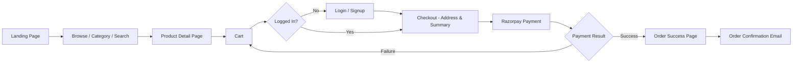

### 1.1 Step-by-Step Description

1. **Landing**: Hero collage, "Shop by Category" grid, featured products, footer. A floating WhatsApp contact button (PRD §16) appears on all storefront pages when `settings.whatsapp_enabled = true` and a number is configured — reads via `lib/settings/service.ts` (never raw JSONB).
2. **Browse**: Category pages or search results with filters (price, variant/size, availability) and sorting.
3. **Product**: Full-page PDP — gallery, description, price, stock status, variant selector, ratings/reviews, FAQs, share button. PDP URL uses the descriptive, keyword-rich slug convention (PRD §15.9), e.g., `/product/elastic-bedsheet-floral-blue` — never an opaque ID.
4. **Cart**: Add/update/remove items; quantities; subtotal. Cart is usable by guests (stored client-side, merged on login).
5. **Auth Gate**: Clicking "Checkout" while unauthenticated redirects to `/login?redirect=/checkout`; after successful login/signup, the user is returned directly to checkout with cart intact.
6. **Checkout**: Select or add a delivery address → confirm contact email/phone → review final bill (subtotal, shipping, tax, total).
7. **Payment**: Razorpay checkout widget (UPI/cards/netbanking/wallets as enabled in the Razorpay account).
8. **Success**: Order confirmation page with order ID and summary; confirmation email sent.
9. **Failure**: On payment failure/cancellation, user is returned to cart/checkout with a clear retry option; no order is marked `confirmed` until payment is verified server-side.

---

## 2. Admin Flow (High Level)

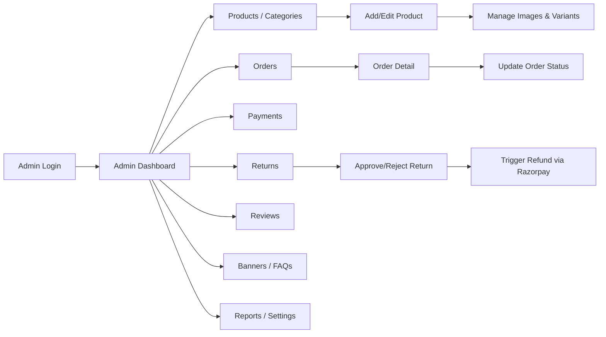

### 2.1 Step-by-Step Description

1. **Login**: Single admin account, email + password (Supabase Auth), with forgot-password flow. After password reset, the `/reset-password` Server Action redirects to `/admin/login` if `auth.uid() === ADMIN_USER_ID`, otherwise to `/login` (see §7.2).
2. **Dashboard**: Summary cards (today's revenue, pending orders, low-stock count) + revenue-over-time chart (Recharts).
3. **Products/Categories**: List, search, filter products; add/edit product (details, images, variants, price, stock, SEO fields); set product status to `draft`, `active`, or `archived`. **Products are never hard-deleted through the admin UI — archiving (`status = 'archived'`) is the only supported removal action** (see RULES.md §19). CRUD categories (categories may be deactivated via `is_active = false`; hard deletion of a category is blocked by the `ON DELETE RESTRICT` FK on `products.category_id`).
4. **Orders**: List with status filters; detail view; status transitions (accept → processing → shipped → delivered, or cancelled). When marking an order `shipped`, the admin may optionally enter a `tracking_number` and `tracking_url`; these are stored on the `orders` row and surfaced in the "Order Shipped" email and on `/account/orders/[id]`.
5. **Payments**: Transaction list; revenue-over-time graph; export to CSV/Excel.
6. **Returns**: Review return requests; approve/reject; on approval, trigger Razorpay refund; status updates propagate to customer.
7. **Reviews**: Moderate (approve/hide/delete) customer-submitted reviews. Seed reviews (`is_seed = true`) are visually flagged in the queue — admin can hide or delete them individually as real reviews accumulate. No automated retirement flow.
8. **Banners/FAQs**: CRUD homepage banners (honest promotional content only) and FAQ entries.
9. **Reports/Settings**: Export monthly/PnL-style reports; configure site-wide settings (policies, thresholds, contact info, WhatsApp settings) — all settings reads/writes go through `lib/settings/service.ts` (typed, Zod v4 validated — never raw JSONB).

---

## 3. Order Lifecycle (State Diagram)

```mermaid
stateDiagram-v2
    [*] --> Pending: Order created (pre-payment)
    Pending --> PaymentFailed: Razorpay payment fails/cancelled OR stock insufficient at verification
    Pending --> Confirmed: Payment verified (signature + rpc_order_confirm atomic transaction)
    PaymentFailed --> Pending: Customer retries payment
    PaymentFailed --> [*]: Abandoned (no retry)
    Confirmed --> Processing: Admin accepts order
    Processing --> Shipped: Admin marks shipped (optional tracking_number/tracking_url saved to orders; orders.shipped_at set)
    Shipped --> Delivered: Admin marks delivered
    Confirmed --> Cancelled: Admin or customer cancels (before shipping)
    Processing --> Cancelled: Admin cancels (before shipping)
    Delivered --> ReturnRequested: Customer requests return (within window)
    Cancelled --> RefundInitiated: If payment was captured
    ReturnRequested --> [*]: See Return Lifecycle
    Delivered --> [*]: Order complete (no return)
    RefundInitiated --> [*]
```

**Status Enum**: `pending`, `payment_failed`, `confirmed`, `processing`, `shipped`, `delivered`, `cancelled`.

**Notes**:
- An order only becomes `confirmed` after the `rpc_order_confirm` Postgres function succeeds — this single atomic transaction verifies stock, decrements inventory, inserts `inventory_movements`, and updates `orders.status`. It is invoked from `/api/razorpay/verify-payment` after server-side HMAC signature verification. Webhook (`payment.captured`) reconciles any gaps where the client callback fails.
- If `rpc_order_confirm` finds stock insufficient for any line item, it rolls back entirely, sets `orders.status = 'payment_failed'`, and initiates a Razorpay refund if payment was already captured. No inventory is decremented in this case.
- `cancelled` is possible only before `shipped`; once `shipped`, the customer path is `delivered` → return (via Returns Lifecycle, §5), not order cancellation.
- `orders.shipped_at TIMESTAMPTZ` is set when the admin transitions an order to `shipped`, enabling SLA monitoring (TECHSPEC §12.4).
- All transitions are admin-initiated (FR-35) except `pending → confirmed/payment_failed`, which is system-driven.

---

## 4. Payment Lifecycle (State Diagram)

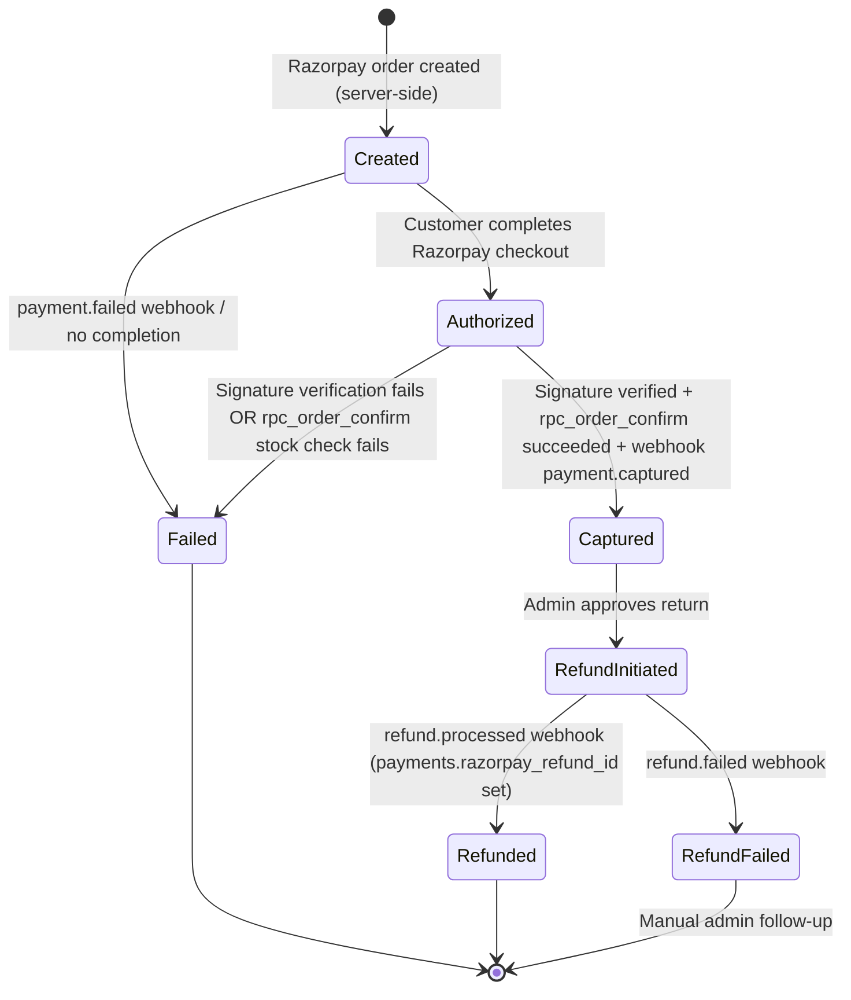

**Status Enum**: `created`, `authorized`, `captured`, `failed`, `refund_initiated`, `refunded`, `refund_failed`.

**Notes**:
- `payments` table rows are keyed by `razorpay_payment_id` (unique, with a partial unique index where NOT NULL) to guarantee idempotency across duplicate webhook deliveries.
- `payments.razorpay_refund_id` (unique) is set when the Razorpay refund is confirmed via `refund.processed` webhook, enabling structured refund reconciliation against Razorpay's dashboard.
- `refund_failed` requires manual admin investigation (visible as a flagged state in the Payments admin view).

---

## 5. Return Lifecycle (State Diagram)

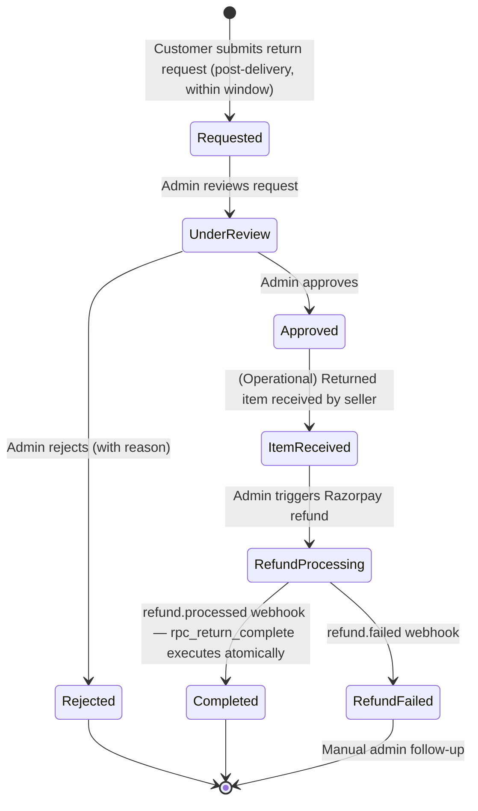

**Status Enum**: `requested`, `under_review`, `approved`, `rejected`, `item_received`, `refund_processing`, `completed`, `refund_failed`.

**Notes**:
- Return eligibility is governed by a configurable window (e.g., 7 days from `delivered_at`), stored in `settings.return_window_days` and read via `lib/settings/service.ts`.
- `item_received` is a manually-set status by the admin (no courier integration in v1).
- On `completed`, the `rpc_return_complete` Postgres function executes atomically via `supabase.rpc()`: updates `returns.status = 'completed'`, sets `payments.status = 'refunded'` and `payments.razorpay_refund_id`, and optionally restocks inventory if the item is resellable — all in a single Postgres transaction.

### 5.1 Return Flow Enhancements (High-Level Summary with Notifications)

The detailed state diagram above is the authoritative model. The simplified flow below summarizes the customer-/admin-visible journey and explicitly ties each transition to the corresponding notification (see §9 Notification Flow) and inventory effect (see §10 Inventory Flow):

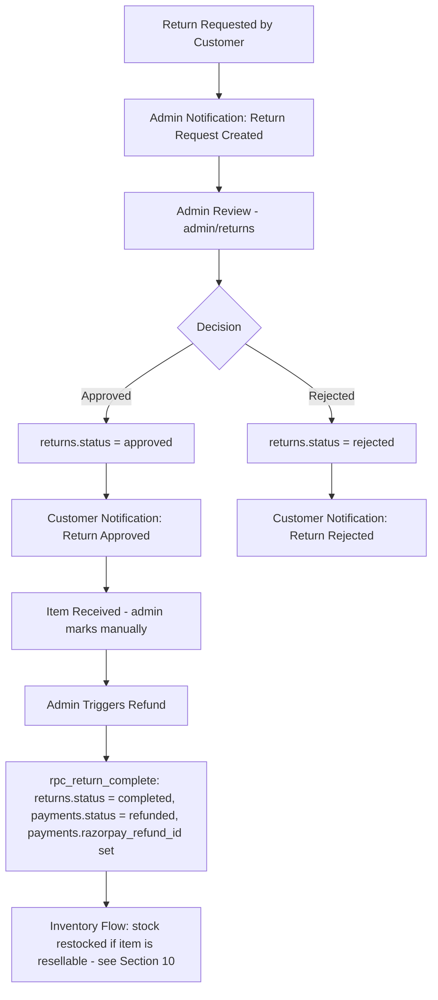

- **Admin Review** (step C) is where the admin reads the customer's `reason`/`comments` and decides `approved` vs `rejected`, optionally adding `admin_notes`.
- Both terminal customer-facing outcomes (`Return Approved` and `Return Rejected`) generate a customer email per PRD.md §14 — a hard requirement so the customer is never left wondering.
- A restock (`inventory_movements.change_type = 'return'`) only occurs if the admin determines the returned item is resellable; otherwise a `manual_adjustment` write-off is recorded (see §10).

---

## 6. Cart Flow (Browsing Without Login, Login Required Before Checkout)

> **v1 Clarification**: Product browsing (Landing, PLP, PDP, and adding items to a cart) is available **without login**. **Login is required before checkout.** The guest cart in v1 is intentionally **simple**: a local-storage/cookie-based list of `{product_id, product_variant_id, quantity}` with no backend persistence and no complex multi-step reconciliation logic. A more elaborate cross-device guest-cart-merge system is **not** built in v1 unless explicitly required later (see PRD.md Future Opportunities).

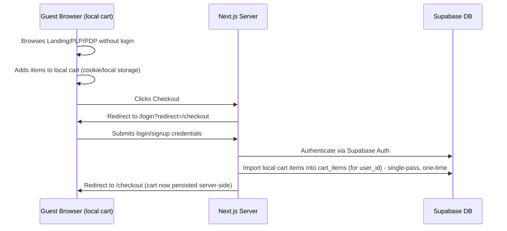

- **Import, not merge**: On successful login/signup from the checkout redirect, the local cart items are upserted into `cart_items` for `user_id`. If a matching `(user_id, product_id, variant_id)` row already exists, quantities are summed and capped at `stock_quantity` with a toast notification. This is the entirety of the "merge" — a single upsert per line item, not a multi-step reconciliation engine.
- After a successful import, the local/guest cart is cleared.
- Stock sufficiency is **not** validated at this import step — it is validated definitively and atomically via `rpc_order_confirm` at payment verification (APPFLOW §10.1), which is the single authoritative point.
- This flow directly satisfies PRD FR-14 ("Product Browsing Without Login") and FR-16 ("Login Before Checkout") without requiring a guest-facing `cart_items`-equivalent table or server-side guest sessions.

---

## 7. Authentication Flows

### 7.1 Customer Signup/Login
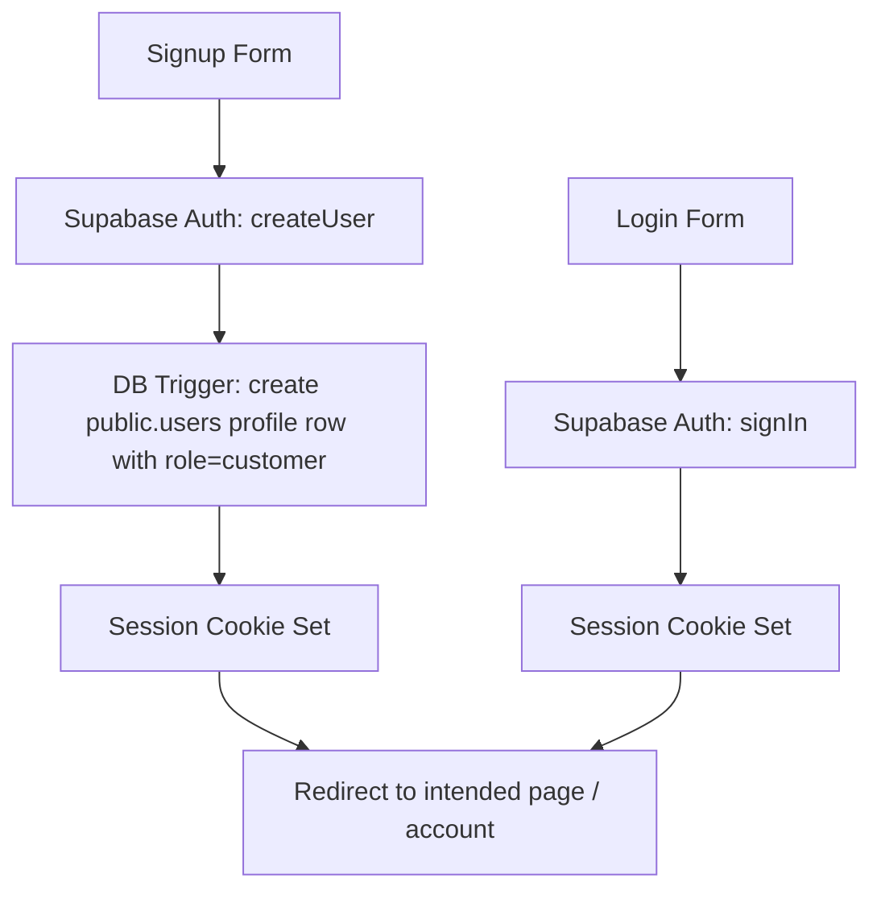

### 7.2 Forgot Password (Customer & Admin — Shared Flow with Role-Aware Redirect)

```mermaid
graph TD
    A[Forgot Password Form] --> B[Supabase Auth: resetPasswordForEmail]
    B --> C[Email sent with reset link via Resend SMTP]
    C --> D[User clicks link -> /reset-password]
    D --> E[New password form]
    E --> F[Supabase Auth: updateUser password]
    F --> G{auth.uid() === ADMIN_USER_ID env var?}
    G -- Yes --> H[Redirect to /admin/login]
    G -- No --> I[Redirect to /login]
```

**Notes**:
- The forgot-password and reset-password flows are shared between customer and admin — there is no separate admin forgot-password page. The reset email is sent by Supabase Auth using the Resend SMTP provider configured in Phase 1.
- The role-aware redirect is implemented in the `/reset-password` Server Action: after `supabase.auth.updateUser({ password })`, the Server Action reads the current session's `uid`, compares it to `process.env.ADMIN_USER_ID` **server-side**, and redirects accordingly. `ADMIN_USER_ID` is **never** exposed to the client or included in any response body.
- Both redirect targets (`/admin/login` and `/login`) present a fresh login prompt, requiring the admin/customer to sign in with their new password. The reset does not automatically create a new session.

### 7.3 Admin Login Guard (proxy.ts)
```mermaid
graph TD
    A[Request to /admin/*] --> B{Session valid?}
    B -- No --> C[Redirect to /admin/login]
    B -- Yes --> D{public.users.role == admin AND auth.uid() == ADMIN_USER_ID env var?}
    D -- No --> E[403 Forbidden / Redirect to storefront]
    D -- Yes --> F[Render Admin Route]
```

**Notes**:
- This guard is implemented in `proxy.ts` (the Next.js 16 replacement for the deprecated `middleware.ts`) — the file is named `proxy.ts` and exports `proxy` or a default export. The named `middleware` export is deprecated in Next.js 16.
- The `ADMIN_USER_ID` check is server-side only — never exposed to the client.

---

## 8. Review Submission Flow

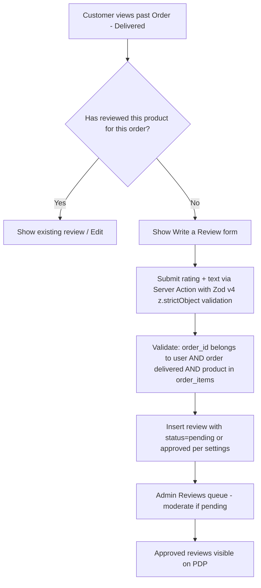

- Seed/launch reviews (10–15 mock reviews per PRD §12 note) are inserted via migration/seed script with `is_seed = true` so they are clearly identifiable in the admin `/admin/reviews` queue. Retirement is manual: the admin hides or deletes individual seed reviews via the existing moderation interface as genuine verified-purchase reviews accumulate. No automated retirement flow is built in v1. The `is_seed` flag is display-only — it has no effect on storefront rendering (seed reviews with `status = 'approved'` appear on the PDP identically to verified-purchase reviews).

---

## 9. Notification Flow

This flow shows how a single business event (a successful payment) fans out into the customer- and admin-facing notifications defined in PRD.md §14. The same fan-out pattern (event → `lib/notifications/resend.ts` → email) applies to every notification listed in PRD §14.2/§14.3.

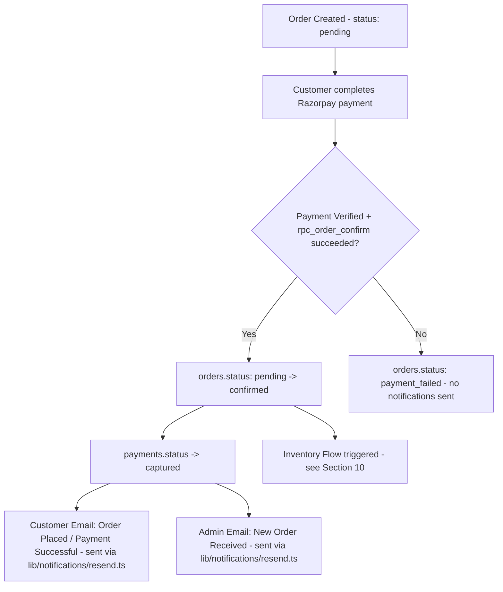

### 9.1 General Pattern for All Notifications
Every notification in PRD §14 follows the same shape:

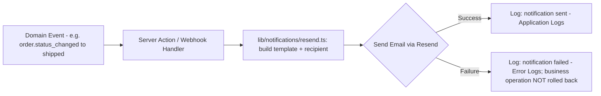

### 9.2 Notification Triggers Summary

| Event | Customer Email | Admin Email |
|-------|------------------|--------------|
| `orders.status: pending -> confirmed` | Order Placed / Payment Successful | New Order Received |
| `orders.status -> processing` | Order Accepted | — |
| `orders.status -> shipped` | Order Shipped (incl. `tracking_number` + `tracking_url` if set; "on its way" fallback if NULL) | — |
| `orders.status -> delivered` | Order Delivered | — |
| `returns` row created (`status = requested`) | — | Return Request Created |
| `returns.status -> approved` | Return Approved | — |
| `returns.status -> rejected` | Return Rejected | — |
| `products`/`product_variants` stock crosses ≤ `low_stock_threshold` (inherited from parent `products` row) | — | Low Stock Alert |

### 9.3 Notes
- Notification sending is **fire-and-forget relative to the triggering transaction** — the database transaction that changes `orders.status`/`returns.status`/stock levels commits regardless of whether the email succeeds (per PRD §14.4 and RULES.md). Failures are logged, never surfaced as user-facing errors.
- All emails are sent via **Resend** (`lib/notifications/resend.ts`) — the sole transactional email provider for v1. Resend SMTP is configured in Supabase project settings during Phase 1 so that Supabase auth emails (password reset) also use the same verified sending domain.
- The "New Order Received" and "Order Placed" emails may be triggered from the same Server Action/webhook handler that sets `orders.status = 'confirmed'`.

---

## 10. Inventory Flow

This flow documents how `products`/`product_variants` stock levels, `inventory_movements` (SCHEMA.md §3.17), and `audit_logs` (SCHEMA.md §3.16) stay consistent as orders are paid, returned, or manually adjusted.

### 10.1 Order Paid → Inventory Reduced (Primary Flow via rpc_order_confirm)

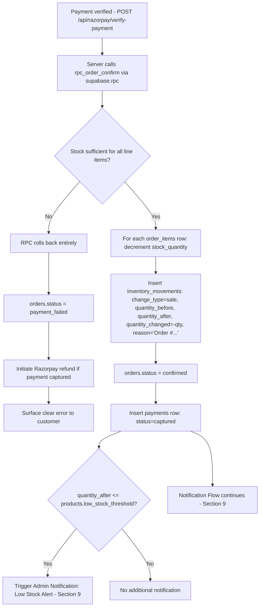

- Steps H–K execute within a **single Postgres transaction** inside `rpc_order_confirm`, called via `supabase.rpc()` from the `/api/razorpay/verify-payment` Route Handler. This ensures stock, the order status, `inventory_movements`, and the `payments` row are always consistent.
- For variant-tracked products, `low_stock_threshold` is read from the **parent `products` row** — variants have no independent threshold in v1 (RULES.md §11.7).
- The `/api/razorpay/verify-payment` Route Handler must use `await req.text()` (not `req.json()`) to obtain the raw request body for HMAC signature verification before any JSON parsing.
- This flow does **not** create an `audit_logs` row — `sale`-type inventory movements are system-driven, not admin-initiated actions.

### 10.2 Manual Inventory Adjustment (Admin-Initiated)

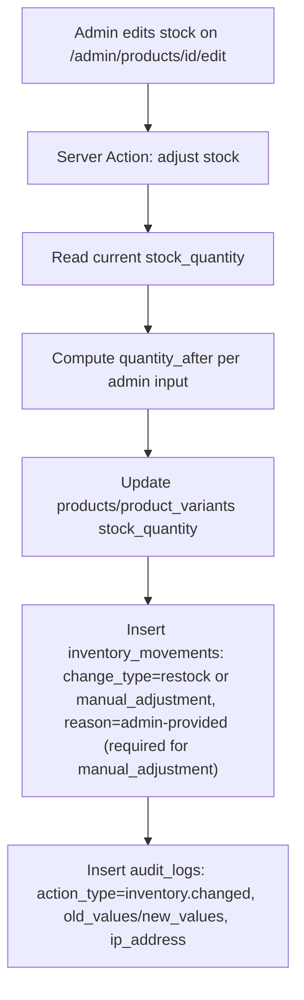

- Both `restock` (stock increase) and `manual_adjustment` (correction/write-off) follow this pattern. `manual_adjustment` requires a non-empty `reason` field — Server Actions validate this with Zod v4 before persisting (RULES.md §11.4).
- Every manual inventory update is logged in both `inventory_movements` (the stock ledger) and `audit_logs` (the admin accountability trail) — `inventory_movements` answers "what happened to stock and why", `audit_logs` answers "which admin did it, when, and from where (IP)".

### 10.3 Return Completed → Inventory Restocked (Conditional, via rpc_return_complete)

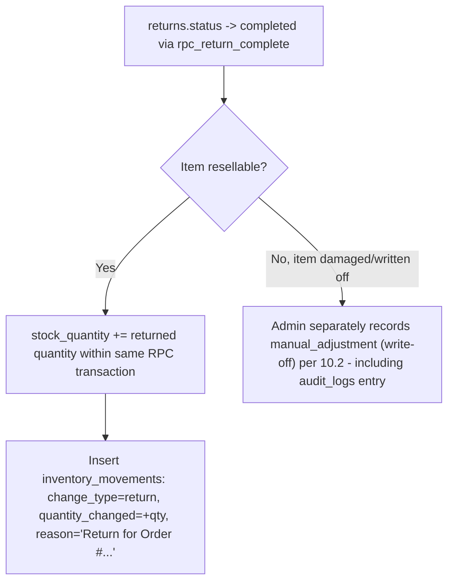

- `rpc_return_complete` executes atomically: `returns.status`, `payments.status`, `payments.razorpay_refund_id`, and optional stock restock all happen in a single Postgres transaction via `supabase.rpc()`.
- The "resellable?" decision is a manual admin judgment at the `item_received` stage.

### 10.4 Summary: Inventory Consistency Invariant

At any point in time, for a given `product_id`/`variant_id`:

```
products.stock_quantity (or product_variants.stock_quantity)
    == quantity_after of the most recent inventory_movements row for that product/variant
```

This invariant is the basis for a periodic data-integrity check. **No code path may update `stock_quantity` without also inserting a corresponding `inventory_movements` row in the same transaction** (RULES.md §11.1). For atomic multi-table operations this is enforced by using `rpc_order_confirm` and `rpc_return_complete` Postgres functions (RULES.md §1.7 / TECHSPEC §6).
