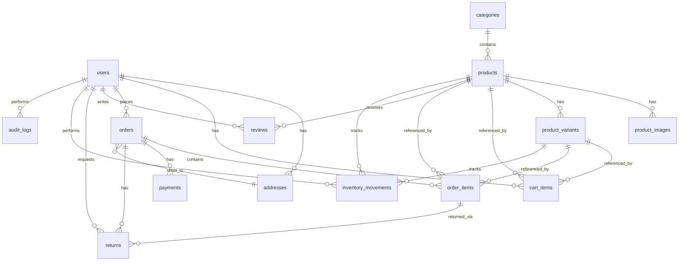

> ⚠️ **SUPERSEDED (2026-07-27, Phase 26):** This document describes the original Supabase-backed ecommerce architecture (database, admin panel, checkout, or similar) and does **not** reflect the current codebase. As of Phase 26, the site is fully static — no database, no admin panel, no authentication of any kind. See `HANDOFF.md` and `docs/PROJECT_STATUS.md` for the current architecture. Kept here for historical reference only.

---

# Database Schema (SCHEMA)
## ACE DÉCOR — Supabase PostgreSQL Production Schema

**Document Status:** Source of Truth — v2.0
**Notes:** This document defines the schema conceptually (tables, columns, types, relationships, constraints, indexes). Actual SQL migration files are implemented separately under `supabase/migrations/` per RULES.md — this document is the authoritative reference for what those migrations must produce.

---

## 1. Conventions

- All primary keys: `id UUID DEFAULT gen_random_uuid()`.
- All tables include `created_at TIMESTAMPTZ DEFAULT now()` and `updated_at TIMESTAMPTZ DEFAULT now()` (maintained via trigger).
- Monetary values: `NUMERIC(10,2)`, stored in INR (rupees), GST-inclusive unless otherwise noted.
- Enums implemented as Postgres `CHECK` constraints on `TEXT` columns (portable, easy to extend via migration) — values also mirrored in Zod enums (`lib/validation/`).
- Foreign keys use `ON DELETE RESTRICT` by default for referential integrity in financial/order data, and `ON DELETE CASCADE` only for clearly dependent child rows (e.g., `product_images` on `products`, `cart_items` on `cart`/`users`).
- **Required Postgres extensions** (enabled in the first migration, before any table creation):
  - `CREATE EXTENSION IF NOT EXISTS "uuid-ossp";` — for `gen_random_uuid()` on older Postgres versions (Supabase >= 15 provides it natively but including it is harmless).
  - `CREATE EXTENSION IF NOT EXISTS pg_trgm;` — required for trigram GIN indexes on `products.name` (typo-tolerant search fallback, TECHSPEC §15.5). **Must be in the first migration.** Later migrations that create trigram indexes will fail silently or error without this extension enabled.

---

## 2. Entity-Relationship Diagram

---

## 3. Table Definitions

### 3.1 `users`

Profile table mirroring `auth.users` (Supabase-managed). Populated via trigger on `auth.users` insert.

| Column | Type | Constraints |
|--------|------|-------------|
| `id` | UUID | PK, = `auth.users.id` (FK to `auth.users.id`) |
| `email` | TEXT | NOT NULL, UNIQUE |
| `full_name` | TEXT | NULL |
| `phone` | TEXT | NULL |
| `role` | TEXT | NOT NULL, DEFAULT `'customer'`, CHECK IN (`'customer'`, `'admin'`) |
| `created_at` | TIMESTAMPTZ | DEFAULT now() |
| `updated_at` | TIMESTAMPTZ | DEFAULT now() |

**Relationships**: 1:N → `addresses`, `cart_items`, `orders`, `reviews`, `returns`.

**Constraints/Business Rules**:
- Exactly one row may have `role = 'admin'`. Enforced via a partial unique index: `CREATE UNIQUE INDEX one_admin_only ON users ((role = 'admin')) WHERE role = 'admin';` (ensures at most one row has `role='admin'`).
- The admin row's `id` should additionally match a configured `ADMIN_USER_ID` env var, checked at the application/middleware layer.

**Indexes**:
- `UNIQUE (email)`
- `one_admin_only` partial unique index (above)

---

### 3.2 `addresses`

| Column | Type | Constraints |
|--------|------|-------------|
| `id` | UUID | PK |
| `user_id` | UUID | NOT NULL, FK → `users.id` ON DELETE CASCADE |
| `full_name` | TEXT | NOT NULL |
| `phone` | TEXT | NOT NULL |
| `line1` | TEXT | NOT NULL |
| `line2` | TEXT | NULL |
| `landmark` | TEXT | NULL |
| `city` | TEXT | NOT NULL |
| `state` | TEXT | NOT NULL |
| `pincode` | TEXT | NOT NULL, CHECK (pincode matches `^[0-9]{6}$`) |
| `address_type` | TEXT | NULL, CHECK IN (`'home'`, `'work'`, `'other'`) |
| `is_default` | BOOLEAN | NOT NULL, DEFAULT false |
| `created_at` | TIMESTAMPTZ | DEFAULT now() |
| `updated_at` | TIMESTAMPTZ | DEFAULT now() |

**Relationships**: N:1 → `users`. 1:N ← `orders` (via `shipping_address_id`).

**Indexes**:
- `INDEX (user_id)`
- Partial unique index ensuring only one `is_default = true` per `user_id` (enforced via trigger or partial unique index on `(user_id) WHERE is_default`).

---

### 3.3 `categories`

| Column | Type | Constraints |
|--------|------|-------------|
| `id` | UUID | PK |
| `name` | TEXT | NOT NULL, UNIQUE |
| `slug` | TEXT | NOT NULL, UNIQUE |
| `description` | TEXT | NULL |
| `image_url` | TEXT | NULL (Supabase Storage URL) |
| `display_order` | INTEGER | NOT NULL, DEFAULT 0 |
| `is_active` | BOOLEAN | NOT NULL, DEFAULT true |
| `created_at` | TIMESTAMPTZ | DEFAULT now() |
| `updated_at` | TIMESTAMPTZ | DEFAULT now() |

**Seed Data**: Cushion Covers, Pillow Covers, Plastic Bedsheets, Elastic Bedsheets, Table Covers, AC Curtains, Grass Mats, AC Covers, Booster Covers.

**Relationships**: 1:N → `products`.

**Indexes**: `UNIQUE (slug)`, `INDEX (display_order)`, `INDEX (is_active)`.

---

### 3.4 `products`

| Column | Type | Constraints |
|--------|------|-------------|
| `id` | UUID | PK |
| `category_id` | UUID | NOT NULL, FK → `categories.id` ON DELETE RESTRICT |
| `name` | TEXT | NOT NULL |
| `slug` | TEXT | NOT NULL, UNIQUE |
| `short_description` | TEXT | NOT NULL |
| `description` | TEXT | NULL (rich text, sanitized HTML) |
| `base_price` | NUMERIC(10,2) | NOT NULL, CHECK (base_price >= 0) |
| `stock_quantity` | INTEGER | NOT NULL, DEFAULT 0, CHECK (stock_quantity >= 0) |
| `low_stock_threshold` | INTEGER | NOT NULL, DEFAULT 5, CHECK (low_stock_threshold >= 0) |
| `status` | TEXT | NOT NULL, DEFAULT `'draft'`, CHECK IN (`'draft'`, `'active'`, `'archived'`) |
| `meta_title` | TEXT | NULL |
| `meta_description` | TEXT | NULL |
| `created_at` | TIMESTAMPTZ | DEFAULT now() |
| `updated_at` | TIMESTAMPTZ | DEFAULT now() |

**Computed/Derived (application-level, not stored)**: `stock_status` = `'out_of_stock'` if `stock_quantity = 0`; `'only_few_left'` if `0 < stock_quantity <= low_stock_threshold`; else `'in_stock'`. For products with variants, `stock_status` per variant is derived from `product_variants.stock_quantity` compared against `products.low_stock_threshold` (inherited — variants have no independent threshold in v1; see §3.6 Notes). The product-level `stock_quantity` represents the simple/no-variant case or an aggregate.

**Search support (additive)**: A `search_vector TSVECTOR` column (generated/maintained via trigger from `name`, `short_description`, `description`, joined `categories.name`, and `product_variants.name`, per weighting in TECHSPEC §15.2) supports full-text search and is indexed via GIN (see §6). A trigram GIN index on `name` supports typo-tolerant fallback search (TECHSPEC §15.5). These are additive columns/indexes — they do not change any existing column's meaning.

**Relationships**: N:1 → `categories`. 1:N → `product_images`, `product_variants`, `cart_items`, `order_items`, `reviews`.

**Indexes**:
- `UNIQUE (slug)`
- `INDEX (category_id)`
- `INDEX (status)`
- Composite `INDEX (category_id, status)` for category-filtered active product listing.

---

### 3.5 `product_images`

| Column | Type | Constraints |
|--------|------|-------------|
| `id` | UUID | PK |
| `product_id` | UUID | NOT NULL, FK → `products.id` ON DELETE CASCADE |
| `url` | TEXT | NOT NULL (Supabase Storage URL) |
| `alt_text` | TEXT | NOT NULL |
| `blur_data_url` | TEXT | NULL (base64-encoded tiny placeholder generated at upload time, used with `next/image` `placeholder="blur"` — see TECHSPEC §16.5) |
| `display_order` | INTEGER | NOT NULL, DEFAULT 0 |
| `is_primary` | BOOLEAN | NOT NULL, DEFAULT false |
| `created_at` | TIMESTAMPTZ | DEFAULT now() |

**Relationships**: N:1 → `products`.

**Constraints**: Partial unique index ensuring at most one `is_primary = true` per `product_id`.

**Indexes**: `INDEX (product_id, display_order)`.

---

### 3.6 `product_variants`

Represents size/type variants (e.g., Table Cover 60x90 / 40x60 / 48x48; AC Curtain 7ft / 9ft).

| Column | Type | Constraints |
|--------|------|-------------|
| `id` | UUID | PK |
| `product_id` | UUID | NOT NULL, FK → `products.id` ON DELETE CASCADE |
| `name` | TEXT | NOT NULL (e.g., "60x90 cm", "7ft") |
| `sku` | TEXT | NOT NULL, UNIQUE |
| `price_override` | NUMERIC(10,2) | NULL, CHECK (price_override IS NULL OR price_override >= 0) |
| `stock_quantity` | INTEGER | NOT NULL, DEFAULT 0, CHECK (stock_quantity >= 0) |
| `is_active` | BOOLEAN | NOT NULL, DEFAULT true |
| `created_at` | TIMESTAMPTZ | DEFAULT now() |
| `updated_at` | TIMESTAMPTZ | DEFAULT now() |

**Relationships**: N:1 → `products`. 1:N → `cart_items`, `order_items`.

**Indexes**: `UNIQUE (sku)`, `INDEX (product_id)`.

**Notes**:
- `price_override` is used when a variant has a different price than `products.base_price`; effective price = `COALESCE(price_override, products.base_price)`.
- **Low stock threshold**: `product_variants` has no independent `low_stock_threshold` column in v1. The threshold for variant-level low-stock comparisons is always inherited from the parent `products.low_stock_threshold` via a join. No application code may hardcode a threshold value or read it from anywhere other than `products.low_stock_threshold` for both product-level and variant-level stock checks (RULES.md §11.7). This is a deliberate v1 simplification; a per-variant threshold can be added as a migration in a future version without breaking the existing constraint.

---

### 3.7 `cart_items`

Server-side cart for authenticated users (guest carts handled client-side until merge).

| Column | Type | Constraints |
|--------|------|-------------|
| `id` | UUID | PK |
| `user_id` | UUID | NOT NULL, FK → `users.id` ON DELETE CASCADE |
| `product_id` | UUID | NOT NULL, FK → `products.id` ON DELETE CASCADE |
| `product_variant_id` | UUID | NULL, FK → `product_variants.id` ON DELETE CASCADE |
| `quantity` | INTEGER | NOT NULL, CHECK (quantity > 0) |
| `created_at` | TIMESTAMPTZ | DEFAULT now() |
| `updated_at` | TIMESTAMPTZ | DEFAULT now() |

**Relationships**: N:1 → `users`, `products`, `product_variants`.

**Constraints**: `UNIQUE (user_id, product_id, product_variant_id)` — adding the same product/variant again increments `quantity` rather than creating a duplicate row.

**Indexes**: `INDEX (user_id)`.

---

### 3.8 `orders`

| Column | Type | Constraints |
|--------|------|-------------|
| `id` | UUID | PK |
| `user_id` | UUID | NOT NULL, FK → `users.id` ON DELETE RESTRICT |
| `shipping_address_id` | UUID | NOT NULL, FK → `addresses.id` ON DELETE RESTRICT |
| `order_number` | TEXT | NOT NULL, UNIQUE (human-readable, e.g., `ACE-20260613-0001`) |
| `status` | TEXT | NOT NULL, DEFAULT `'pending'`, CHECK IN (`'pending'`, `'payment_failed'`, `'confirmed'`, `'processing'`, `'shipped'`, `'delivered'`, `'cancelled'`) |
| `subtotal` | NUMERIC(10,2) | NOT NULL, CHECK (subtotal >= 0) |
| `shipping_fee` | NUMERIC(10,2) | NOT NULL, DEFAULT 0, CHECK (shipping_fee >= 0) |
| `tax_amount` | NUMERIC(10,2) | NOT NULL, DEFAULT 0, CHECK (tax_amount >= 0) |
| `total_amount` | NUMERIC(10,2) | NOT NULL, CHECK (total_amount >= 0) |
| `contact_email` | TEXT | NOT NULL |
| `contact_phone` | TEXT | NOT NULL |
| `placed_at` | TIMESTAMPTZ | NULL (set when status moves to `confirmed`) |
| `shipped_at` | TIMESTAMPTZ | NULL (set when status moves to `shipped`) |
| `delivered_at` | TIMESTAMPTZ | NULL |
| `cancelled_at` | TIMESTAMPTZ | NULL |
| `tracking_number` | TEXT | NULL — carrier tracking number entered by admin when marking an order `shipped`; shown to customer on `/account/orders/[id]` |
| `tracking_url` | TEXT | NULL — full tracking deeplink (e.g., `https://www.delhivery.com/track/package/XXXXXXX`); if provided, rendered as a clickable "Track Your Order" link in the shipped email and order detail page |
| `created_at` | TIMESTAMPTZ | DEFAULT now() |
| `updated_at` | TIMESTAMPTZ | DEFAULT now() |

**Relationships**: N:1 → `users`, `addresses`. 1:N → `order_items`, `payments`, `returns`.

**Indexes**:
- `UNIQUE (order_number)`
- `INDEX (user_id)`
- `INDEX (status)`
- `INDEX (created_at)` (for date-range admin queries/reports)

---

### 3.9 `order_items`

Snapshot of purchased items (price/name captured at time of order — must not change if product is later edited).

| Column | Type | Constraints |
|--------|------|-------------|
| `id` | UUID | PK |
| `order_id` | UUID | NOT NULL, FK → `orders.id` ON DELETE CASCADE |
| `product_id` | UUID | NOT NULL, FK → `products.id` ON DELETE RESTRICT |
| `product_variant_id` | UUID | NULL, FK → `product_variants.id` ON DELETE RESTRICT |
| `product_name_snapshot` | TEXT | NOT NULL |
| `variant_name_snapshot` | TEXT | NULL |
| `unit_price_snapshot` | NUMERIC(10,2) | NOT NULL, CHECK (unit_price_snapshot >= 0) |
| `quantity` | INTEGER | NOT NULL, CHECK (quantity > 0) |
| `line_total` | NUMERIC(10,2) | NOT NULL, CHECK (line_total >= 0) |
| `created_at` | TIMESTAMPTZ | DEFAULT now() |

**Relationships**: N:1 → `orders`, `products`, `product_variants`. 1:N → `returns` (via `order_item_id`).

**Indexes**: `INDEX (order_id)`, `INDEX (product_id)`.

---

### 3.10 `payments`

| Column | Type | Constraints |
|--------|------|-------------|
| `id` | UUID | PK |
| `order_id` | UUID | NOT NULL, FK → `orders.id` ON DELETE RESTRICT |
| `razorpay_order_id` | TEXT | NOT NULL |
| `razorpay_payment_id` | TEXT | NULL, UNIQUE |
| `status` | TEXT | NOT NULL, DEFAULT `'created'`, CHECK IN (`'created'`, `'authorized'`, `'captured'`, `'failed'`, `'refund_initiated'`, `'refunded'`, `'refund_failed'`) |
| `amount` | NUMERIC(10,2) | NOT NULL, CHECK (amount >= 0) |
| `currency` | TEXT | NOT NULL, DEFAULT `'INR'` |
| `method` | TEXT | NULL (e.g., `'upi'`, `'card'`, `'netbanking'`, `'wallet'`) |
| `failure_reason` | TEXT | NULL |
| `refunded_amount` | NUMERIC(10,2) | NULL, CHECK (refunded_amount IS NULL OR refunded_amount >= 0) |
| `razorpay_refund_id` | TEXT | NULL, UNIQUE — set when Razorpay processes a refund; used for idempotency on `refund.processed` webhook events exactly as `razorpay_payment_id` is used for `payment.captured` events |
| `created_at` | TIMESTAMPTZ | DEFAULT now() |
| `updated_at` | TIMESTAMPTZ | DEFAULT now() |

**Relationships**: N:1 → `orders` (one order may have multiple `payments` rows across retries, but at most one `captured`).

**Indexes**:
- `UNIQUE (razorpay_payment_id)` (where NOT NULL)
- `UNIQUE (razorpay_refund_id)` (where NOT NULL)
- `INDEX (order_id)`
- `INDEX (razorpay_order_id)`
- `INDEX (status)`

---

### 3.11 `reviews`

| Column | Type | Constraints |
|--------|------|-------------|
| `id` | UUID | PK |
| `product_id` | UUID | NOT NULL, FK → `products.id` ON DELETE CASCADE |
| `user_id` | UUID | NULL, FK → `users.id` ON DELETE SET NULL (nullable to allow seed reviews without a real user) |
| `order_item_id` | UUID | NULL, FK → `order_items.id` ON DELETE SET NULL (verified-purchase link) |
| `rating` | SMALLINT | NOT NULL, CHECK (rating BETWEEN 1 AND 5) |
| `title` | TEXT | NULL |
| `body` | TEXT | NOT NULL |
| `reviewer_name` | TEXT | NOT NULL (display name; for seed data, a representative name) |
| `is_seed` | BOOLEAN | NOT NULL, DEFAULT false |
| `status` | TEXT | NOT NULL, DEFAULT `'approved'`, CHECK IN (`'pending'`, `'approved'`, `'hidden'`) |
| `created_at` | TIMESTAMPTZ | DEFAULT now() |
| `updated_at` | TIMESTAMPTZ | DEFAULT now() |

**Relationships**: N:1 → `products`, `users`, `order_items`.

**Constraints**: `UNIQUE (user_id, order_item_id)` where both NOT NULL — one review per purchased line item.

**Indexes**: `INDEX (product_id, status)`.

---

### 3.12 `returns`

| Column | Type | Constraints |
|--------|------|-------------|
| `id` | UUID | PK |
| `order_id` | UUID | NOT NULL, FK → `orders.id` ON DELETE RESTRICT |
| `order_item_id` | UUID | NOT NULL, FK → `order_items.id` ON DELETE RESTRICT |
| `user_id` | UUID | NOT NULL, FK → `users.id` ON DELETE RESTRICT |
| `reason` | TEXT | NOT NULL |
| `comments` | TEXT | NULL |
| `status` | TEXT | NOT NULL, DEFAULT `'requested'`, CHECK IN (`'requested'`, `'under_review'`, `'approved'`, `'rejected'`, `'item_received'`, `'refund_processing'`, `'completed'`, `'refund_failed'`) |
| `admin_notes` | TEXT | NULL |
| `requested_at` | TIMESTAMPTZ | DEFAULT now() |
| `resolved_at` | TIMESTAMPTZ | NULL |
| `created_at` | TIMESTAMPTZ | DEFAULT now() |
| `updated_at` | TIMESTAMPTZ | DEFAULT now() |

**Relationships**: N:1 → `orders`, `order_items`, `users`.

**Indexes**: `INDEX (order_id)`, `INDEX (status)`, `INDEX (user_id)`.

---

### 3.13 `banners`

| Column | Type | Constraints |
|--------|------|-------------|
| `id` | UUID | PK |
| `title` | TEXT | NOT NULL |
| `subtitle` | TEXT | NULL |
| `image_url` | TEXT | NOT NULL (Supabase Storage URL) |
| `link_url` | TEXT | NULL (internal route, e.g., `/shop/cushion-covers`) |
| `display_order` | INTEGER | NOT NULL, DEFAULT 0 |
| `is_active` | BOOLEAN | NOT NULL, DEFAULT true |
| `starts_at` | TIMESTAMPTZ | NULL |
| `ends_at` | TIMESTAMPTZ | NULL |
| `created_at` | TIMESTAMPTZ | DEFAULT now() |
| `updated_at` | TIMESTAMPTZ | DEFAULT now() |

**Indexes**: `INDEX (is_active, display_order)`.

**Business Rule**: Banner content must comply with PRD merchandising rules — no fake discount/sale text. Enforced editorially (admin policy), not technically, but documented here as a constraint on content.

---

### 3.14 `faq_items`

| Column | Type | Constraints |
|--------|------|-------------|
| `id` | UUID | PK |
| `question` | TEXT | NOT NULL |
| `answer` | TEXT | NOT NULL |
| `category` | TEXT | NULL (e.g., `'shipping'`, `'returns'`, `'payments'`, `'general'`) |
| `display_order` | INTEGER | NOT NULL, DEFAULT 0 |
| `is_active` | BOOLEAN | NOT NULL, DEFAULT true |
| `created_at` | TIMESTAMPTZ | DEFAULT now() |
| `updated_at` | TIMESTAMPTZ | DEFAULT now() |

**Indexes**: `INDEX (category, display_order)`.

---

### 3.15 `settings`

Single-row (or key-value) configuration table for store-wide settings.

**Recommended Implementation**: Key-value rows for flexibility.

| Column | Type | Constraints |
|--------|------|-------------|
| `key` | TEXT | PK |
| `value` | JSONB | NOT NULL |
| `updated_at` | TIMESTAMPTZ | DEFAULT now() |

**Expected Keys** (seeded at setup):
- `shipping_policy_text`, `return_policy_text`, `privacy_policy_text`, `terms_text`
- `return_window_days` (e.g., `7`)
- `contact_email`, `contact_phone`
- `social_links` (JSON object: instagram, facebook, etc.)
- `default_shipping_fee`, `free_shipping_threshold`
- `gst_display_note`
- `low_stock_threshold_default`
- `whatsapp_enabled` (`boolean`, default `false`) — master on/off for the floating WhatsApp button (PRD §16)
- `whatsapp_number` (`string`, default `""`) — Indian mobile in international format, e.g. `919876543210`

**Indexes**: PK on `key` is sufficient.

**Type Safety**: Raw `JSONB` values from this table must never be consumed directly by UI components or business logic. All reads and writes go through `lib/settings/service.ts`, which parses each key's value through its corresponding Zod v4 schema in `lib/validation/settings.schema.ts`. See RULES.md §18 and TECHSPEC §6 (Settings type safety).

---

### 3.16 `audit_logs` (Supplemental — supports FR-32 audit trail and enterprise-grade traceability)

Required by PRD §9 (Security Requirements, audit logging), TECHSPEC §11 (Admin Activity Logs), and RULES.md (Audit Rules). Included here as part of the core schema — every critical admin action must produce a row in this table.

| Column | Type | Constraints |
|--------|------|-------------|
| `id` | UUID | PK |
| `admin_id` | UUID | NOT NULL, FK → `users.id` ON DELETE SET NULL (the acting admin — there is only ever one, but the FK preserves the record if the account were ever removed) |
| `action_type` | TEXT | NOT NULL (see Action Types below) |
| `entity_type` | TEXT | NOT NULL (e.g., `'product'`, `'order'`, `'banner'`, `'settings'`, `'inventory'`) |
| `entity_id` | UUID | NOT NULL |
| `old_values` | JSONB | NULL — snapshot of affected fields before the change |
| `new_values` | JSONB | NULL — snapshot of affected fields after the change |
| `ip_address` | INET | NULL — IP address of the admin session that performed the action, captured server-side from the request |
| `created_at` | TIMESTAMPTZ | DEFAULT now() |

> **Naming note**: `admin_id`, `old_values`, and `new_values` are the canonical column names (aligned with this enhancement pass). Earlier drafts of this document referred to the equivalent concepts as `actor_id`, `before`, and `after` — these are the same fields under updated naming and should be treated as a single migration if the table was already created under the earlier names.

**Action Types Tracked** (`action_type` values):
- `product.created`
- `product.updated`
- `product.deleted`
- `product.price_changed`
- `inventory.changed` (correlates with a row in `inventory_movements`, §3.17, where `change_type = 'manual_adjustment'`)
- `order.status_changed`
- `banner.updated`
- `settings.updated`
- (extensible — additional action types follow the `entity.verb_past_tense` convention and are added to `lib/constants.ts` per RULES.md §3.5)

**Retention Strategy**:
- `audit_logs` rows are retained **indefinitely** by default, consistent with TECHSPEC §11.5 — this table is the durable accountability record for the single-admin model and is expected to remain relatively small in row-size terms relative to `orders`/`order_items`.
- If row volume becomes operationally significant (multi-year horizon), older rows (e.g., > 2 years) may be exported/archived to cold storage (e.g., a periodic export to a file in Supabase Storage or an external archive) rather than deleted — deletion of audit history is discouraged and, if ever required for compliance reasons, must itself be a logged, deliberate admin action.

**Indexes**: `INDEX (entity_type, entity_id)`, `INDEX (admin_id)`, `INDEX (created_at)`, `INDEX (action_type)`.

---

### 3.17 `inventory_movements`

**Purpose**: Provide a complete, append-only audit trail of every change to product/variant stock levels — sales, returns, restocks, and manual adjustments — so that current stock figures (`products.stock_quantity`, `product_variants.stock_quantity`) are always explainable and reconcilable against a historical ledger. This directly supports RULES.md's Inventory Rules ("every inventory change must create an `inventory_movements` record").

| Column | Type | Constraints |
|--------|------|-------------|
| `id` | UUID | PK |
| `product_id` | UUID | NOT NULL, FK → `products.id` ON DELETE RESTRICT |
| `variant_id` | UUID | NULL, FK → `product_variants.id` ON DELETE RESTRICT (NULL when the product has no variants and stock is tracked at the product level) |
| `change_type` | TEXT | NOT NULL, CHECK IN (`'sale'`, `'return'`, `'restock'`, `'manual_adjustment'`) |
| `quantity_before` | INTEGER | NOT NULL, CHECK (quantity_before >= 0) |
| `quantity_after` | INTEGER | NOT NULL, CHECK (quantity_after >= 0) |
| `quantity_changed` | INTEGER | NOT NULL (signed — positive for increases such as `restock`/`return`, negative for decreases such as `sale`; CHECK (quantity_changed = quantity_after - quantity_before)) |
| `reason` | TEXT | NULL (free-text context, e.g., `'Order #ACE-20260613-0001'`, `'Damaged stock written off'`, `'Supplier restock - 50 units'`) |
| `created_by` | UUID | NOT NULL, FK → `users.id` ON DELETE SET NULL (the admin who performed/triggered the change; for system-driven `sale`/`return` movements, this is the single admin account, since there is no separate system-service user in v1) |
| `created_at` | TIMESTAMPTZ | DEFAULT now() |

**Change Types**:
- `sale` — stock decremented when an order transitions `pending → confirmed` (payment verified). `quantity_changed` is negative, equal to `-order_items.quantity` for the corresponding product/variant.
- `return` — stock incremented when a `returns` row reaches `status = 'completed'` and the returned item is restocked (per APPFLOW.md return lifecycle; if a returned item is *not* restockable, e.g., damaged, the admin instead records a `manual_adjustment` with a `reason` noting the write-off, and no `return` movement is created).
- `restock` — stock incremented by the admin when new inventory arrives (e.g., via the product edit screen's "Add Stock" action).
- `manual_adjustment` — any other admin-initiated correction (stock count corrections, damage write-offs, etc.); always requires a non-empty `reason`.

**Relationships**:
- N:1 → `products` (every movement belongs to exactly one product).
- N:1 → `product_variants` (optional — present only for variant-tracked products).
- N:1 → `users` (via `created_by`).
- Logically related to `order_items` and `returns` via the `reason` field for `sale`/`return` movements (not a formal FK, to keep the table append-only and simple — the order/return identifiers are embedded in `reason` as human-readable text, e.g., `'Order #ACE-20260613-0001'`). A future enhancement could add nullable `order_item_id`/`return_id` FK columns if structured cross-referencing becomes necessary; not required for v1.
- Logically related to `audit_logs` — a `manual_adjustment` movement is always accompanied by an `audit_logs` row with `action_type = 'inventory.changed'` (per RULES.md Audit Rules).

**Indexing Strategy**:
- `INDEX (product_id, created_at)` — primary access pattern: "show the stock history for this product over time" (admin product detail view).
- `INDEX (variant_id, created_at)` — same, scoped to a specific variant.
- `INDEX (change_type)` — supports admin/reporting queries like "all manual adjustments this month" or "all restocks this quarter".
- `INDEX (created_by)` — supports audit queries ("what inventory changes did the admin make").

**Usage Examples**:
- *Order confirmed*: When `orders.status` transitions to `confirmed` (APPFLOW.md Order Lifecycle), for each `order_items` row the system inserts an `inventory_movements` row with `change_type = 'sale'`, `quantity_before` = current stock, `quantity_changed = -order_items.quantity`, `quantity_after = quantity_before + quantity_changed`, and `reason = 'Order #' || orders.order_number`. The corresponding `products.stock_quantity` (or `product_variants.stock_quantity`) is updated in the same transaction.
- *Return completed and restocked*: When a `returns` row reaches `completed` and the admin marks the item as restockable, an `inventory_movements` row with `change_type = 'return'`, `quantity_changed = +order_items.quantity` (or a partial quantity if only part of the line was returned), and `reason = 'Return for Order #' || orders.order_number` is created.
- *Admin restocks a product*: Admin enters "+50 units" on a product's stock field; the system records `change_type = 'restock'`, `quantity_changed = +50`, `reason` optionally containing supplier/PO reference text entered by the admin.
- *Stock correction*: Admin performs a physical stock count and finds 3 fewer units than recorded; admin enters a manual adjustment of `-3` with `reason = 'Physical stock count correction - 13 Jun 2026'`, producing `change_type = 'manual_adjustment'` and a corresponding `audit_logs` row (`action_type = 'inventory.changed'`).
- *Reconciliation query*: `products.stock_quantity` at any point in time should equal the `quantity_after` of the most recent `inventory_movements` row for that `product_id`/`variant_id` — this invariant can be used as a periodic data-integrity check.

**Indexes**: `(product_id, created_at)`, `(variant_id, created_at)`, `(change_type)`, `(created_by)`.

---

## 4. Storage Structure (Supabase Storage)

| Bucket | Access | Path Convention | Notes |
|--------|--------|------------------|-------|
| `product-images` | Public read; admin-only write | `products/{product_id}/{uuid}.{ext}` | Referenced by `product_images.url` |
| `banners` | Public read; admin-only write | `banners/{uuid}.{ext}` | Referenced by `banners.image_url` |
| `categories` | Public read; admin-only write | `categories/{category_id}/{uuid}.{ext}` | Referenced by `categories.image_url` |
| `branding` | Public read; admin-only write | `branding/{filename}` | Logo, favicon, static brand assets |

**Validation Rules** (enforced in Server Actions before upload):
- Allowed MIME types: `image/jpeg`, `image/png`, `image/webp`.
- Max file size: 5MB per image.
- Filenames are server-generated UUIDs to prevent path traversal and collisions; original filename stored only as `alt_text` reference if needed.

---

## 5. RLS (Row-Level Security) Strategy

**Global rule**: RLS is enabled on every table in `public` schema. No table is left with RLS disabled, including lookup tables (`categories`, `faq_items`, `settings`, `banners`) — these get permissive read policies for `anon`/`authenticated` and restrictive write policies for `admin`.

### 5.1 Roles Used in Policies
- `anon` — unauthenticated Supabase role (public storefront browsing).
- `authenticated` — any logged-in user (customer or admin).
- Application-level distinction between `customer` and `admin` is done via a helper function `is_admin(uid uuid)` that checks `public.users.role = 'admin' AND id = uid`, used inside policies.

### 5.2 Policy Summary by Table

| Table | `anon` SELECT | `authenticated` (own rows) | `admin` |
|-------|----------------|------------------------------|---------|
| `users` | ❌ | SELECT/UPDATE own row only | Full SELECT (for order fulfillment context); no ability to change `role` of own row arbitrarily (role changes restricted to migration/manual ops) |
| `addresses` | ❌ | Full CRUD on own rows (`user_id = auth.uid()`) | SELECT only (to view shipping address for orders) |
| `categories` | SELECT where `is_active = true` | same as anon | Full CRUD |
| `products` | SELECT where `status = 'active'` | same as anon | Full CRUD (all statuses) |
| `product_images` | SELECT (joined via active product) | same as anon | Full CRUD |
| `product_variants` | SELECT where `is_active = true` (joined via active product) | same as anon | Full CRUD |
| `cart_items` | ❌ | Full CRUD on own rows (`user_id = auth.uid()`) | ❌ (admin has no business reason to view customer carts) |
| `orders` | ❌ | SELECT own rows; INSERT own (via Server Action only); no direct UPDATE | Full SELECT/UPDATE (status transitions) |
| `order_items` | ❌ | SELECT own (via order ownership) | Full SELECT; INSERT via Server Action at order creation |
| `payments` | ❌ | SELECT own (via order ownership), no write | Full SELECT; writes via service-role webhook handler only |
| `reviews` | SELECT where `status = 'approved'` | same as anon + INSERT own (subject to verified-purchase check in Server Action) + UPDATE/DELETE own | Full CRUD (moderation) |
| `returns` | ❌ | SELECT/INSERT own rows; no UPDATE (status changes are admin-only) | Full SELECT/UPDATE |
| `banners` | SELECT where `is_active = true` | same as anon | Full CRUD |
| `faq_items` | SELECT where `is_active = true` | same as anon | Full CRUD |
| `settings` | SELECT (non-sensitive keys only — consider a view) | same as anon | Full CRUD |
| `inventory_movements` | ❌ | ❌ | Full SELECT (read-only stock history); INSERT via Server Actions (order confirmation, return completion, restock, manual adjustment) — never client-writable directly |
| `audit_logs` | ❌ | ❌ | Full SELECT (read-only audit trail); INSERT via server-side Server Actions/triggers only — never client-writable directly |

### 5.3 Notes on Sensitive Operations
- **Order creation**: Performed via a Server Action using the user's authenticated session (RLS-respecting client) for the initial `orders`/`order_items` insert (status `pending`), ensuring `user_id = auth.uid()`.
- **Payment/Order status updates from webhooks**: The Razorpay webhook Route Handler runs with the Supabase **secret key** (`SUPABASE_SECRET_KEY`, replaces legacy `SUPABASE_SERVICE_ROLE_KEY`; bypasses RLS) because it is not tied to a user session — this is the one sanctioned use of the secret key for write operations, and it must independently verify the Razorpay webhook signature before any write (see TECHSPEC §10).
- **Admin identity check**: `is_admin(auth.uid())` helper function used across policies; additionally, `proxy.ts` (the Next.js 16 replacement for the deprecated `middleware.ts`) double-checks `auth.uid() = ADMIN_USER_ID` for `(admin)` routes as a second layer (see TECHSPEC §4).
- **Inventory movements**: Written in the same server-side transaction as the corresponding `products`/`product_variants` stock update (order confirmation, return completion, restock, manual adjustment) — never inserted independently, to guarantee the `quantity_before`/`quantity_after`/`quantity_changed` invariants in §3.17 always hold.

---

## 6. Indexing Summary (Quick Reference)

| Table | Indexes |
|-------|---------|
| `users` | `email` (unique), partial unique on admin role |
| `addresses` | `user_id`, partial unique default-address |
| `categories` | `slug` (unique), `display_order`, `is_active` |
| `products` | `slug` (unique), `category_id`, `status`, `(category_id, status)`, GIN on `search_vector` (see TECHSPEC §15), GIN trigram on `name` (typo tolerance) |
| `product_images` | `(product_id, display_order)`, partial unique primary image |
| `product_variants` | `sku` (unique), `product_id` |
| `cart_items` | `user_id`, unique `(user_id, product_id, product_variant_id)` |
| `orders` | `order_number` (unique), `user_id`, `status`, `created_at` |
| `order_items` | `order_id`, `product_id` |
| `payments` | `razorpay_payment_id` (unique, partial where NOT NULL), `razorpay_refund_id` (unique, partial where NOT NULL), `order_id`, `razorpay_order_id`, `status` |
| `reviews` | `(product_id, status)`, unique `(user_id, order_item_id)` |
| `returns` | `order_id`, `status`, `user_id` |
| `banners` | `(is_active, display_order)` |
| `faq_items` | `(category, display_order)` |
| `settings` | PK `key` |
| `inventory_movements` | `(product_id, created_at)`, `(variant_id, created_at)`, `change_type`, `created_by` |
| `audit_logs` | `(entity_type, entity_id)`, `admin_id`, `created_at`, `action_type` |

---

## 7. Future Extension Notes (Not Built Now)

- **Multi-admin/staff roles**: Would require expanding `users.role` CHECK constraint to include e.g. `'staff'`, plus a `permissions` table, plus relaxing the `one_admin_only` partial unique index. Documented here so a future migration path is understood, but **not implemented in v1** per the single-admin business rule.
- **Coupons/Promotions**: Would require a `coupons` table and `orders.discount_amount` column. Explicitly excluded per business rules (PRD §13) — schema intentionally has no discount/coupon columns on `orders` or `order_items` beyond the honest `shipping_fee`/`tax_amount` breakdown.
- **Wishlist**: Would require a `wishlist_items` table mirroring `cart_items` structure — future opportunity per PRD §11.
