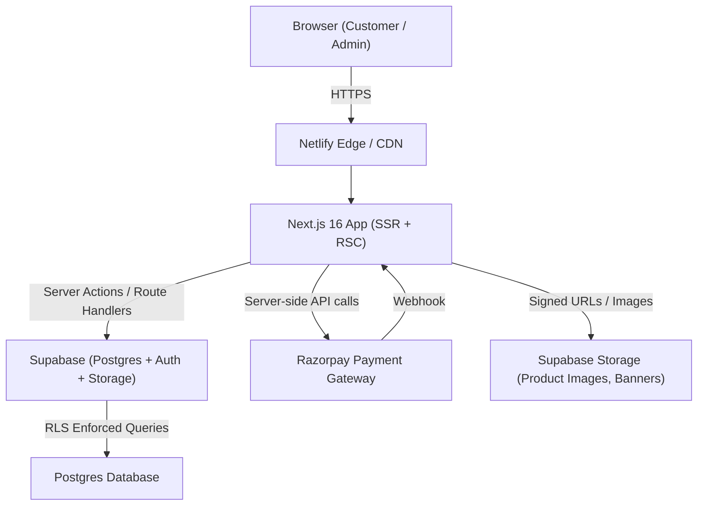
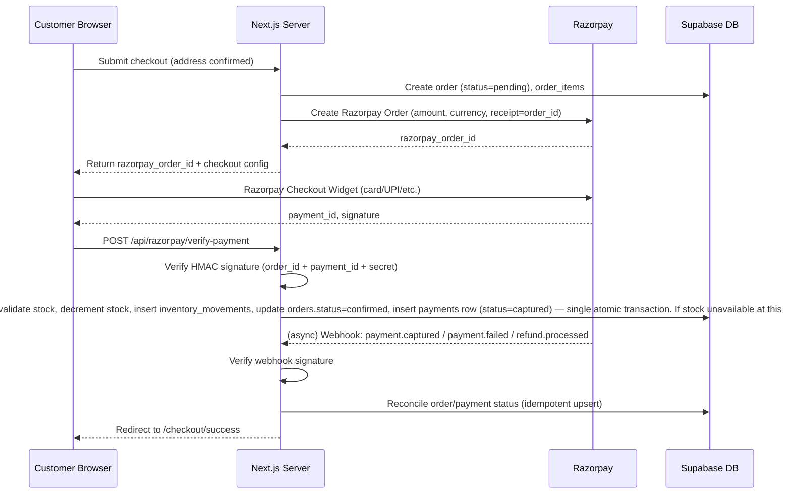
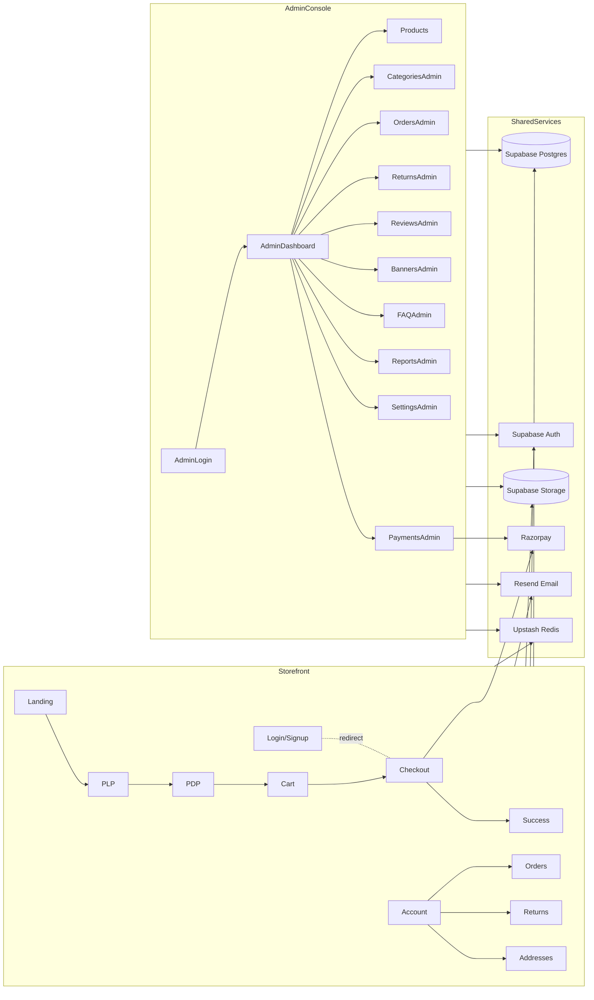

> ⚠️ **SUPERSEDED (2026-07-27, Phase 26):** This document describes the original Supabase-backed ecommerce architecture (database, admin panel, checkout, or similar) and does **not** reflect the current codebase. As of Phase 26, the site is fully static — no database, no admin panel, no authentication of any kind. See `HANDOFF.md` and `docs/PROJECT_STATUS.md` for the current architecture. Kept here for historical reference only.

---

# Technical Specification (TECHSPEC)
## ACE DÉCOR — Architecture & Engineering Blueprint

**Document Status:** Source of Truth — v2.0
**Related Documents:** PRD.md, APPFLOW.md, SCHEMA.md, DESIGN_SYSTEM.md, RULES.md

> **⚠ ERRATUM (2026-07-05 dependency/config audit):** every mention of `proxy.ts`
> in this document (and in RULES.md, IMPLEMENTATION_PLAN.md, APPFLOW.md,
> ADMIN_SETUP.md) is correct about the *filename* but wrong about its
> *location* — it must live at `src/proxy.ts`, not the project root, because
> this project uses the `src/` directory layout. A root-level `proxy.ts` is
> silently never detected or executed by Next.js. This was a real, confirmed
> bug present since Phase 1: all route-level auth protection (admin gating,
> `/account`/`/checkout` redirects, session refresh) never actually ran, on
> any request, until this was found and fixed. See the corrected file tree
> entry below and `src/proxy.ts`'s own header comment for full detail on how
> this was verified and why it went undetected for 23+ phases.

---

## 1. Architecture Overview

ACE DÉCOR is a **single Next.js 16 application** (App Router) deployed to Netlify, providing both the customer storefront and the admin console as route groups within the same codebase. All server-side logic uses **Server Actions** (for mutations triggered from forms/UI) and **Route Handlers** (for webhook endpoints, third-party integrations, and any API consumed by client components needing fetch-based access).



### 1.1 Key Architectural Principles
- **Server-first**: Default to React Server Components; client components only where interactivity (forms, cart, filters, animations) requires it.
- **Single source of truth for data access**: All reads/writes go through typed Supabase client wrappers in `lib/supabase/`, never ad-hoc fetches.
- **Defense in depth**: Authorization checked at proxy (`proxy.ts`), server action, and RLS levels (never RLS alone).
- **Stateless app servers**: No in-memory session/cart state; all persisted state lives in Postgres (orders, authenticated cart) or signed cookies (session; and a simple local-storage guest cart for unauthenticated browsing — see APPFLOW.md §6 for the v1-simplified guest cart approach, not a server-tracked "guest cart token").
- **Idempotency for payments**: Order/payment state transitions are idempotent and replay-safe (webhook + client confirmation may both fire).

---

## 2. Folder Structure

```
ace-decor/
├── app/
│   ├── (storefront)/
│   │   ├── page.tsx                     # Landing page
│   │   ├── layout.tsx                   # Storefront layout (navbar/footer)
│   │   ├── shop/
│   │   │   ├── page.tsx                 # All products / PLP
│   │   │   └── [category]/page.tsx      # Category PLP
│   │   ├── product/[slug]/page.tsx      # PDP
│   │   ├── cart/page.tsx
│   │   ├── checkout/
│   │   │   ├── page.tsx                 # Address + summary
│   │   │   └── success/page.tsx
│   │   ├── account/
│   │   │   ├── page.tsx                 # Profile
│   │   │   ├── orders/page.tsx
│   │   │   ├── orders/[id]/page.tsx
│   │   │   ├── addresses/page.tsx
│   │   │   └── returns/page.tsx
│   │   ├── faq/page.tsx
│   │   └── policies/[slug]/page.tsx     # Shipping/Returns/Privacy/Terms
│   │
│   ├── (auth)/
│   │   ├── login/page.tsx
│   │   ├── signup/page.tsx
│   │   ├── forgot-password/page.tsx
│   │   └── reset-password/page.tsx
│   │
│   ├── (admin)/
│   │   ├── layout.tsx                   # Admin shell (sidebar, guarded)
│   │   ├── login/page.tsx               # Admin-only login
│   │   ├── dashboard/page.tsx
│   │   ├── products/
│   │   │   ├── page.tsx
│   │   │   ├── new/page.tsx
│   │   │   └── [id]/edit/page.tsx
│   │   ├── categories/page.tsx
│   │   ├── orders/
│   │   │   ├── page.tsx
│   │   │   └── [id]/page.tsx
│   │   ├── payments/page.tsx
│   │   ├── returns/page.tsx
│   │   ├── reviews/page.tsx
│   │   ├── banners/page.tsx
│   │   ├── faqs/page.tsx
│   │   ├── reports/page.tsx
│   │   └── settings/page.tsx
│   │
│   ├── api/
│   │   ├── razorpay/
│   │   │   ├── create-order/route.ts
│   │   │   ├── verify-payment/route.ts
│   │   │   └── webhook/route.ts
│   │   ├── invoice/[orderId]/route.ts
│   │   ├── healthcheck/route.ts          # GET /api/healthcheck — uptime monitoring (TECHSPEC §12.1)
│   │   └── sitemap.xml/route.ts
│   │
│   ├── layout.tsx                       # Root layout (next/font/google, CSS vars)
│   └── globals.css                      # @import "tailwindcss"; @theme {} design tokens
│
├── actions/                              # Server Actions, grouped by domain
│   ├── catalog.ts
│   ├── cart.ts
│   ├── orders.ts
│   ├── auth.ts
│   ├── reviews.ts
│   ├── returns.ts
│   ├── admin-products.ts
│   ├── admin-orders.ts
│   ├── admin-banners.ts
│   └── admin-settings.ts
│
├── components/
│   ├── ui/                              # Shadcn UI primitives (new-york style)
│   ├── storefront/                      # Navbar, ProductCard, Gallery, CartDrawer...
│   ├── admin/                           # AdminSidebar, DataTable, Charts...
│   └── shared/                          # Loaders, EmptyState, ErrorBoundary
│
├── lib/
│   ├── supabase/
│   │   ├── client.ts                    # Browser client (uses NEXT_PUBLIC_SUPABASE_PUBLISHABLE_KEY)
│   │   ├── server.ts                    # Server client (RSC/Server Actions)
│   │   └── types.ts                     # Generated DB types
│   ├── razorpay/
│   │   └── client.ts
│   ├── ratelimit/
│   │   └── client.ts                    # Upstash Redis rate limiter (@upstash/ratelimit)
│   ├── notifications/
│   │   └── resend.ts                    # Resend email client and send helpers
│   ├── settings/
│   │   └── service.ts                   # Typed getters/setters for settings table
│   ├── validation/                      # Zod v4 schemas (mirrors actions/ domains)
│   │   ├── catalog.schema.ts
│   │   ├── checkout.schema.ts
│   │   ├── settings.schema.ts           # Zod schemas for every settings key
│   │   └── ...
│   ├── auth/
│   │   ├── session.ts
│   │   └── guards.ts                    # requireUser(), requireAdmin()
│   ├── utils/
│   │   ├── format.ts                    # currency, date formatting
│   │   ├── pricing.ts
│   │   └── search.ts                    # shared search query builder
│   ├── monitoring/
│   │   └── index.ts                     # Monitoring seam (Sentry or similar, TECHSPEC §12.2)
│   └── constants.ts
│
├── src/proxy.ts                          # Route protection (auth + admin) — Next.js 16 replaces deprecated middleware.ts
│                                          # ⚠ CORRECTED 2026-07-05: must live under src/ (not project root) because
│                                          # this project uses the src/ directory layout — Next.js only looks for
│                                          # proxy.ts/middleware.ts at src/proxy.ts when a src/ dir exists, and
│                                          # silently never invokes a root-level one. This whole diagram omits the
│                                          # src/ wrapper for brevity (actions/, components/, lib/, app/ above are
│                                          # all really src/actions/, src/components/, etc. in the real codebase) —
│                                          # proxy.ts is called out explicitly here because, uniquely among these,
│                                          # its exact path has framework-enforced behavioral significance.
├── types/                                # Shared TS types/interfaces
├── public/                               # Static assets (logo, favicons)
├── docs/                                 # This documentation package
├── supabase/
│   ├── migrations/                       # SQL migration files
│   └── config.toml
├── .env.example
├── next.config.ts
├── globals.css                           # Tailwind v4: @theme block defines all design system tokens
└── package.json
```

> **Note on `tailwind.config.ts`**: Tailwind v4 uses CSS-first `@theme {}` configuration in `globals.css`. The `tailwind.config.ts` file is **not** the primary configuration surface in v4 and is not listed as a root source file. A thin `tailwind.config.ts` bridge file may be auto-generated by the Shadcn CLI — if present, it is a build-tool artifact, **not** a design token source. All design system tokens from DESIGN_SYSTEM.md §2–§8 must be defined in `globals.css` `@theme {}`, not in a JS config object. See §20.

---

## 3. Authentication Strategy

- **Provider**: Supabase Auth (email/password as baseline; phone OTP optional enhancement).
- **Session Management**: Supabase SSR helpers (`@supabase/ssr`) manage session cookies; `proxy.ts` (the Next.js 16 replacement for the deprecated `middleware.ts`) refreshes sessions on each request via the `createServerClient` cookie-refresh pattern from `@supabase/ssr`.
- **Customer Auth**:
  - Signup creates a `auth.users` row (Supabase-managed) and a corresponding `public.users` profile row (via DB trigger).
  - Login redirect-after-checkout pattern: checkout route checks session; if absent, redirects to `/login?redirect=/checkout` and returns the user post-auth.
- **Admin Auth**:
  - Exactly one admin account, provisioned manually during setup (via Supabase dashboard or a one-time seed script — **not** via public signup).
  - Admin route group `(admin)` protected by `proxy.ts` that checks both (a) valid session and (b) `public.users.role = 'admin'` AND the user's `id` matches the `ADMIN_USER_ID` environment variable (belt-and-suspenders against accidental role escalation — see §9 Deployment Strategy for the `ADMIN_USER_ID` env var definition).
  - **Password reset redirect**: After a successful password reset via `/reset-password`, the Server Action performs a server-side check: if `auth.uid() === ADMIN_USER_ID` (env var), redirect to `/admin/login`; otherwise redirect to `/login`. The `ADMIN_USER_ID` comparison is made server-side only — never exposed to the client or included in any response body.
  - Forgot-password flow reuses Supabase's password-reset email flow, scoped to the admin's email. The reset email is sent by Supabase Auth using the project's configured Resend SMTP provider (see §9 — Resend SMTP must be configured in Supabase project settings during Phase 1).
- **Password Policy**: Minimum 8 characters, enforced client + server side via Zod v4; Supabase handles hashing/storage.

---

## 4. Authorization Strategy

Three enforcement layers (defense in depth):

1. **Proxy (`proxy.ts`)**: Redirects unauthenticated users away from `/account/*`, `/checkout/*`, and the entire `(admin)` group; redirects non-admin authenticated users away from `(admin)`. (`proxy.ts` is the Next.js 16 stable replacement for the deprecated `middleware.ts` convention — runs on Node.js runtime, not Edge.)
2. **Server Actions / Route Handlers**: Every mutation begins with `requireUser()` or `requireAdmin()` helper (from `lib/auth/guards.ts`) that re-validates the session server-side — **never trust proxy alone**, since Server Actions can theoretically be invoked directly.
3. **Row-Level Security (RLS)**: Every table has RLS enabled (see SCHEMA.md §RLS Strategy). Policies ensure:
   - Customers can only `SELECT`/`UPDATE` their own `users`, `addresses`, `cart_items`, `orders`, `returns`.
   - Admin (identified by `role = 'admin'` claim/row) has elevated read/write across operational tables.
   - Public (anon) role has read-only access to published `products`, `product_images`, `product_variants`, `categories`, `banners`, `faq_items`, and approved `reviews`.

---

## 5. API Strategy

- **Primary mutation mechanism**: Next.js **Server Actions**, colocated by domain in `actions/`. Each action:
  1. Validates input with a Zod v4 schema (`z.strictObject()`).
  2. Calls `requireUser()`/`requireAdmin()` as appropriate.
  3. Performs the Supabase operation using the server client.
  4. Returns a typed `{ success, data?, error? }` result for the calling component (no thrown raw errors to the client).
- **Route Handlers** (`app/api/`) used only where a true HTTP endpoint is required:
  - `POST /api/razorpay/create-order` — creates a Razorpay order server-side.
  - `POST /api/razorpay/verify-payment` — verifies payment signature after client-side Razorpay checkout completes.
  - `POST /api/razorpay/webhook` — receives asynchronous Razorpay events (payment captured/failed/refunded), verifies webhook signature, updates `payments`/`orders`.
  - `GET /api/invoice/[orderId]` — on-demand invoice PDF generation (TECHSPEC §17).
  - `GET /api/healthcheck` — returns `{ ok: true, db: true }` for uptime monitoring (TECHSPEC §12.1).
  - `GET /api/sitemap.xml` — dynamic sitemap generation for SEO.
- **No public REST/GraphQL API** is exposed for general catalog consumption beyond what the storefront itself uses; the system is not designed as an API-first platform (out of scope per "no marketplace" rule, but architecture does not preclude future API addition).

---

## 6. Database Strategy

- **Engine**: Supabase PostgreSQL (managed).
- **Migrations**: SQL files in `supabase/migrations/`, applied via Supabase CLI; every schema change is a versioned migration (see RULES.md — Database Rules).
- **Access pattern**: All app queries go through typed Supabase client (`lib/supabase/server.ts`), using generated types from `supabase gen types typescript`.
- **RLS-first**: RLS enabled on all tables from the first migration; policies added alongside table creation (never "RLS later").
- **Soft constraints**: Use Postgres `CHECK` constraints for enums (order status, payment status, stock status) in addition to TypeScript/Zod v4 enums, to prevent invalid states even from direct DB access.
- **Multi-table atomic operations**: Any operation that must atomically update more than one table (e.g., order confirmation flow: stock decrement + `inventory_movements` insert + `orders.status` update) is implemented as a **PostgreSQL function called via `supabase.rpc()`**. These RPC functions run inside a single Postgres transaction, providing true atomicity that cannot be achieved with sequential Supabase client calls. Convention: RPC functions are defined in `supabase/migrations/` alongside the tables they operate on and named `rpc_<domain>_<action>` (e.g., `rpc_order_confirm`, `rpc_return_complete`).
- **Settings type safety**: The `settings` table stores values as `JSONB` for flexibility, but raw JSONB must never be consumed directly by business logic or UI components. All reads and writes go through `lib/settings/service.ts`, which parses each key's value through its corresponding Zod v4 schema defined in `lib/validation/settings.schema.ts`. Type-safe getters (e.g., `getReturnWindowDays(): number`, `getWhatsAppConfig(): WhatsAppSettings`) are the only sanctioned interface. A value that fails Zod parsing throws a typed error caught at the Server Action boundary — never silently returns `undefined` or `any`.
- See SCHEMA.md for full table definitions, relationships, indexes, and ER diagram.

---

## 7. Storage Strategy

- **Provider**: Supabase Storage.
- **Buckets**:
  - `product-images` (public read, admin write) — product gallery images.
  - `banners` (public read, admin write) — homepage banner/promo images.
  - `branding` (public read, admin write) — logo, favicons, static brand assets.
- **Access Control**: Write access via Storage RLS policies restricted to `role = 'admin'`. Public read for all customer-facing buckets (product images/banners must be publicly viewable without auth).
- **Validation**: Server Actions validate file type (JPEG/PNG/WebP only) and size (e.g., max 5MB) before issuing upload; filenames sanitized/UUID-renamed to avoid path traversal or collision issues.
- **Delivery**: Images served via Supabase Storage CDN URLs, consumed through `next/image` for optimization (resizing, lazy loading, responsive `srcset`).

---

## 8. Payment Strategy (Razorpay)



- **Order creation**: Always server-side (`/api/razorpay/create-order`), using `RAZORPAY_KEY_SECRET` (never exposed to client). Only `RAZORPAY_KEY_ID` (public) is sent to the browser for the Checkout widget.
- **Verification**: Client-side success callback is **not trusted alone** — server verifies the HMAC signature using `order_id|payment_id` and the secret, per Razorpay docs.
- **Stock race resolution**: The `rpc_order_confirm` Postgres function performs a final stock sufficiency check before decrementing. If any line item is unavailable at payment verification time, the RPC rolls back entirely, `orders.status` is set to `payment_failed`, and a Razorpay refund is initiated if the payment was already captured. No inventory reservation system exists in v1.
- **Raw body for webhook signature**: The Razorpay webhook Route Handler must call `await req.text()` (not `req.json()`) to obtain the raw request body for HMAC verification before parsing. Parsing before verification will cause signature failures.
- **Webhooks**: A dedicated webhook endpoint handles `payment.captured`, `payment.failed`, `refund.created`, `refund.processed`, with signature verification using `RAZORPAY_WEBHOOK_SECRET`. This is the source of truth for final payment state, even if the client-side callback fails to fire (network drop after payment).
- **Idempotency**: `payments` table has a unique constraint on `razorpay_payment_id` and `razorpay_refund_id`; webhook handlers use upsert logic so retried webhook deliveries don't create duplicates.
- **Refunds**: Admin-initiated (from Returns section) → server calls Razorpay Refunds API → webhook confirms → `payments.status = 'refunded'`, `payments.razorpay_refund_id` set, `returns.status = 'completed'`.

---

## 9. Deployment Strategy

- **Hosting**: Netlify, using the official Next.js Runtime (Netlify adapter for Next.js 16 — OpenNext v5 — supporting App Router, Server Actions, and Route Handlers via Netlify Functions; fully compatible with Next.js 16, zero additional config required).
- **Environments**:
  - `production` — main branch, live domain.
  - `preview` — automatic deploy previews per pull request (Netlify default), pointing to a Supabase **staging** project to avoid polluting production data.
- **Environment Variables** (set in Netlify dashboard, never committed):
  - `NEXT_PUBLIC_SUPABASE_URL`
  - `NEXT_PUBLIC_SUPABASE_PUBLISHABLE_KEY` *(replaces legacy `NEXT_PUBLIC_SUPABASE_ANON_KEY` — new Supabase projects use `sb_publishable_xxx` format keys; legacy anon key still works until end of 2026 but new projects must use the publishable key)*
  - `SUPABASE_SECRET_KEY` (server-only) *(replaces legacy `SUPABASE_SERVICE_ROLE_KEY` — new Supabase projects use `sb_secret_xxx` format keys; same RLS-bypass capability, new naming convention)*
  - `RAZORPAY_KEY_ID` (public), `RAZORPAY_KEY_SECRET` (server-only), `RAZORPAY_WEBHOOK_SECRET` (server-only)
  - `NEXT_PUBLIC_SITE_URL`
  - `ADMIN_USER_ID` (server-only) — the UUID of the single admin account in `auth.users`, provisioned once at setup (Phase 3). Used by `proxy.ts` and `requireAdmin()` as the second identity check on top of `role = 'admin'` (belt-and-suspenders per §4). **Must be set before any admin route is accessible in production. A missing or incorrect value makes the admin console inaccessible.** Copy from `auth.users.id` in the Supabase dashboard after admin provisioning.
  - `UPSTASH_REDIS_REST_URL`, `UPSTASH_REDIS_REST_TOKEN` (server-only) — Upstash Redis for rate limiting (TECHSPEC §10)
  - `RESEND_API_KEY` (server-only) — Resend transactional email (TECHSPEC §11.7)
- **Build**: `next build` with type-checking and lint as required CI steps before deploy (build fails on type errors — pin to Next.js `16.2.9` minimum; versions below `16.2.6` have known security vulnerabilities and must not be used).
- **Domain & TLS**: Custom domain via Netlify DNS/SSL (automatic HTTPS).

---

## 10. Security Strategy

- **Transport**: HTTPS enforced; HSTS header set.
- **Headers**: CSP restricting script/style/img sources to self + Supabase Storage + Razorpay checkout domains; `X-Frame-Options: DENY` (except where Razorpay widget requires an iframe, scoped narrowly); `X-Content-Type-Options: nosniff`; `Referrer-Policy: strict-origin-when-cross-origin`.
- **Input Validation**: **Zod v4** on every Server Action/Route Handler input — reject unknown/extra fields using `z.strictObject()` (Zod v4 replaces the deprecated `.object().strict()` pattern), enforce types/lengths/enums. Use top-level format validators: `z.email()`, `z.url()`, `z.uuid()` (not the deprecated `z.string().email()` chain). Use `{ error: "..." }` for custom error messages, not `{ message: "..." }` (deprecated in Zod v4). Use `.issues` not `.errors` on `ZodError` objects.
- **SQL Injection**: Eliminated by exclusive use of Supabase client (parameterized queries); no raw string-concatenated SQL.
- **XSS**: React's default escaping; no `dangerouslySetInnerHTML` except for sanitized rich-text fields (admin-authored product descriptions sanitized via an allow-list HTML sanitizer before storage and before render).
- **CSRF**: Server Actions use Next.js's built-in action-encryption/origin-check protections; Route Handlers that mutate state validate `Origin`/`Referer` for browser-invoked calls and signatures for webhooks.
- **Rate Limiting**: Applied via **Upstash Redis** (`lib/ratelimit/client.ts`) using the `@upstash/ratelimit` library with a sliding-window algorithm for: login, signup, forgot-password, review submission, checkout-initiation, and webhook endpoints. No `rate_limits` Postgres table is used.
- **Secrets**: All sensitive keys server-only env vars; `.env.example` documents required variables without values.
- **Least Privilege**: `SUPABASE_SECRET_KEY` (replaces legacy `SUPABASE_SERVICE_ROLE_KEY`; bypasses RLS) used **only** in narrowly-scoped server-only utilities (e.g., admin reports, webhook reconciliation) — never in code paths reachable by unauthenticated/customer requests without a role check first.
- **Admin Hardening**: Admin login route should not be linked from public navigation; consider a non-obvious path plus strict rate limiting and optional 2FA (future enhancement).

---

## 11. Logging Architecture

The logging architecture extends the original Logging Strategy with explicit log categories, sources, and retention guidance so that every operationally-significant event in the system is captured, traceable, and retained for an appropriate period.

### 11.1 Application Logs
- Structured JSON logs (`level`, `timestamp`, `domain`, `message`, `context`) emitted from Server Actions/Route Handlers for general application events: page-level errors, cache revalidation events, background/maintenance tasks.
- Source: Next.js server runtime (Netlify Functions logs).
- **Retention recommendation**: 30 days (rolling) — sufficient for debugging recent issues without unbounded growth.

### 11.2 Error Logs
- Centralized error boundary + server-side logging of unhandled exceptions (with stack traces server-side only; generic messages returned to clients).
- Captures: Server Action failures, Route Handler exceptions, Supabase query errors, Razorpay API errors.
- Recommended sink: third-party error tracker (e.g., Sentry) per §12; Netlify Function logs as the fallback for v1.
- **Retention recommendation**: 90 days, to allow correlation with delayed customer reports (e.g., a customer reporting a failed checkout a few weeks later).

### 11.3 Authentication Logs
- Captures: signup, login (success/failure), logout, password-reset request, password-reset completion, admin login (success/failure) — sourced from Supabase Auth logs plus an application-level event log for failed-login rate-limiting context.
- Failed admin login attempts are logged with timestamp and (where available) IP address, supporting the Security Logs category below.
- **Retention recommendation**: 180 days — supports security investigations into account-takeover attempts over a longer window than general error logs.

### 11.4 Payment Logs
- Captures: Razorpay order creation requests/responses (sans secrets), payment verification attempts (success/failure with reason), webhook receipt and signature verification result, refund initiation/result.
- Every `payments` state transition (per APPFLOW.md Payment Lifecycle) is logged with the `razorpay_order_id`/`razorpay_payment_id`, `order_id`, previous status, new status, and timestamp.
- **Retention recommendation**: Minimum 1 year, aligned with typical financial record-keeping and dispute/chargeback investigation windows; consider longer retention (e.g., 7 years) for the `payments` table data itself (database row retention, not just logs) to satisfy Indian tax/accounting recordkeeping norms — confirm with the business owner's accountant.

### 11.5 Admin Activity Logs
- Captures every admin mutation: product create/update/archive, price changes, stock/inventory changes, category changes, order status transitions, return approvals/rejections, banner/FAQ/settings updates.
- Persisted in the `audit_logs` table (see SCHEMA.md §3.16) — this is the durable, queryable record; ephemeral function logs supplement it for short-term debugging only.
- **Retention recommendation**: `audit_logs` table rows are retained indefinitely (or a minimum of 2 years) given the single-admin accountability requirement (FR-32) and the Audit Rules in RULES.md; if storage growth becomes a concern, older rows may be archived to cold storage rather than deleted.

### 11.6 Security Logs
- Captures: rate-limit triggers (login/signup/forgot-password/checkout-initiation/review-submission via Upstash Redis), repeated failed admin login attempts, webhook signature verification failures, RLS-denied access patterns (where detectable), CSP violation reports (if a `report-uri`/`report-to` endpoint is configured).
- These events feed the Alerting Strategy (§12.6) — e.g., repeated webhook signature failures or admin login failures should trigger a notification to the business owner.
- **Retention recommendation**: 180 days, matching Authentication Logs, for consistency in security incident investigations.

### 11.7 Log Destination Summary
- **v1**: Netlify Function logs (application/error/auth/payment/security categories) + `audit_logs` Postgres table (admin activity category, durable). Transactional email is sent via **Resend** (`lib/notifications/resend.ts`). Resend delivery logs (per-email status, bounce/open events) are available in the Resend dashboard — these complement, not replace, the application-level notification send/failure logs.
- **Future**: Pipe Netlify Function logs to a third-party log aggregator (e.g., Logtail, Better Stack, Datadog) for searchability and longer retention without architectural change — `lib/monitoring/` remains the integration seam.

---

## 12. Monitoring Strategy

### 12.1 Uptime Monitoring
- Netlify built-in deploy/build status monitoring for the application tier.
- A `GET /api/healthcheck` Route Handler (returns `{ ok: true, db: true }` + basic DB connectivity check) polled by an external uptime service (e.g., UptimeRobot, Better Stack) on a 1–5 minute interval.
- Supabase project status monitored via the Supabase dashboard/status page.

### 12.2 Error Monitoring
- Recommend integrating an error-tracking SaaS (e.g., Sentry) for both client and server error capture — architecture keeps a clean seam (`lib/monitoring/`) for this even if not wired at launch.
- Error monitoring should tag errors by domain (`checkout`, `admin`, `auth`, `catalog`) to support fast triage.

### 12.3 Payment Monitoring
- Dedicated monitoring of the payment pipeline distinct from general error monitoring, given its business criticality:
  - Count of `payments.status = 'failed'` and `refund_failed` rows over rolling windows (e.g., last 1 hour / 24 hours).
  - Webhook delivery health — alert if no webhook events are received for an extended period while orders are being placed (possible misconfiguration).
  - Discrepancy check (periodic, e.g., daily job): compare `orders` marked `confirmed` against `payments` marked `captured` to catch any reconciliation gaps.

### 12.4 Order Monitoring
- Admin dashboard (per DESIGN_SYSTEM.md §18) surfaces real-time order-related signals: pending orders count, orders stuck in `confirmed`/`processing` beyond an expected SLA (e.g., not moved to `shipped` within 48 hours using `orders.shipped_at`), and low-stock alerts (driven by `products.stock_quantity`/`product_variants.stock_quantity` vs `low_stock_threshold`).
- These same signals are candidates for the Admin Notification "Low Stock Alert" defined in PRD.md's Notification Requirements.

### 12.5 Performance Monitoring
- Core Web Vitals tracked via Netlify Analytics or Google Search Console; Lighthouse CI as part of the release checklist (per IMPLEMENTATION_PLAN.md Phase 21).
- Database query performance monitored via the Supabase dashboard (slow query log, connection counts), with particular attention to PLP filter/sort queries and admin report exports as catalog/order volume grows.

### 12.6 Alerting Strategy
- **Channels**: At minimum, email alerts to the business owner/admin for high-severity events; architecture should not preclude adding SMS/WhatsApp alerting later (see PRD Future Opportunities).
- **High-severity (immediate alert)**: Payment webhook signature failures, `refund_failed` status, uptime check failures, repeated admin login failures (possible brute-force).
- **Medium-severity (daily digest acceptable)**: Low-stock alerts, orders stuck beyond SLA, elevated application error rate.
- **Low-severity (dashboard-only, no alert)**: Routine application logs, individual non-recurring errors.
- Alert thresholds are configuration, not hardcoded — stored in `settings` (e.g., `low_stock_threshold_default`, order-SLA hours) so the admin can tune them without a deploy.

---

## 13. Scalability Strategy

- **Stateless compute**: Next.js serverless functions scale horizontally by default on Netlify.
- **Database**: Supabase Postgres scales vertically (plan upgrades) and supports read replicas if read load grows; all list queries are paginated (cursor or offset-based) from day one.
- **Caching**:
  - Static/ISR caching for landing page, category pages, and PDPs (`revalidate` tags), invalidated on admin product mutation via `revalidatePath`/`revalidateTag`. Note: a product edit touches multiple cache tags — PDP, category PLP, landing page (featured), and sitemap — all must be invalidated together.
  - CDN caching of images via Supabase Storage + Next/Image.
- **Search**: At launch, category/filter-based browsing uses indexed Postgres queries (see SCHEMA.md indexes); if full-text search needs grow, Postgres `tsvector`/`pg_trgm` can be added without architectural change, or an external search service (e.g., Algolia/Meilisearch) can be layered behind the same product-query interface.
- **Decoupling**: Payment, storage, and DB are managed third-party services (Razorpay, Supabase) that scale independently of the app tier.
- **Growth path**: The single-admin, single-brand model is intentional for v1; SCHEMA.md notes where future multi-role/multi-vendor extension points would require migration (without building them now).

---

## 14. High-Level Component/Module Diagram



---

## 15. Search Architecture

### 15.1 Product Search Strategy
- Search is powered initially by **PostgreSQL full-text search** (`tsvector`/`tsquery`), avoiding the operational overhead of a separate search service for v1's catalog size (9 categories, a modest number of SKUs/variants).
- A generated/maintained `search_vector` column (`tsvector`) is added to `products` (via migration, additive — does not change existing columns), combining weighted text from searchable fields.
- The `search_vector` maintenance trigger must cover both `products` row changes **and** `product_variants.name` changes (a separate trigger on `product_variants` that calls the same `tsvector` recomputation on the parent `products` row), so variant name edits are reflected in search without staleness.
- Search queries are executed via the Supabase server client inside the `/shop` PLP Server Component/Server Action, using `@@` matching against `search_vector`, combined with standard `WHERE status = 'active'` and category/price/availability filters already defined in TECHSPEC §5/SCHEMA §3.4.

### 15.2 Searchable Fields
| Field | Source Table | Weight |
|-------|---------------|--------|
| `name` | `products` | A (highest) |
| `category.name` | `categories` (joined) | B |
| `short_description` | `products` | B |
| `description` | `products` | C |
| `product_variants.name` (e.g., "7ft", "60x90") | `product_variants` | C |
| `meta_title` / `meta_description` | `products` | D (lowest) |

### 15.3 Search Ranking
- Results are ranked using `ts_rank` (or `ts_rank_cd` for proximity-aware ranking) against the weighted `search_vector`.
- Secondary ranking tiebreakers (applied after relevance): in-stock products before out-of-stock products; then `display_order`/`created_at` (newest first) as a final tiebreaker.
- Ranking logic lives in a single shared query-builder utility (`lib/utils/search.ts`) so PLP search and any future admin "find product" search reuse the same ranking rules — consistent with RULES.md's "single source of truth" principle.

### 15.4 Search Performance
- A **GIN index** on `products.search_vector` ensures full-text queries remain fast as the catalog grows (see SCHEMA.md §6 indexing summary — this index is additive to the existing index list).
- Search queries are paginated identically to standard PLP browsing (TECHSPEC §13 — cursor or offset-based), so search result pages behave consistently with category browsing.
- Search input is debounced client-side (e.g., 300ms) before triggering a server request, reducing redundant queries during typing.

### 15.5 Typo Tolerance Strategy
- The `pg_trgm` extension is enabled via `CREATE EXTENSION IF NOT EXISTS pg_trgm;` in the **first** database migration (SCHEMA.md §1 — Required Postgres Extensions). This must precede any migration that creates a trigram GIN index; without the extension, the index creation silently fails or errors.
- A **trigram GIN index** is then created on `products.name` (and optionally `categories.name`) in the same migration that adds the `search_vector` column.
- Query flow: (1) attempt a `tsquery` full-text match first; (2) if zero results are returned, fall back to a `pg_trgm` `similarity()`-based query against `products.name` with a configurable similarity threshold (e.g., 0.3), returning "Did you mean…" style near-matches.
- This two-step approach keeps the common case (exact/near-exact matches) fast via the GIN full-text index, while still tolerating minor misspellings (e.g., "cushon cover") without requiring a dedicated search service.

### 15.6 Category Search
- Search can be scoped to a category by combining the full-text/trigram query with `WHERE category_id = :category_id`, enabling an "in this category" search box on `/shop/[category]` pages in addition to the global search.
- Category names themselves are searchable (weight B, §15.2) so a query like "table covers" surfaces the Table Covers category as well as matching products — the PLP search UI may show a small "category match" affordance above product results.

### 15.7 Future Search Scalability
- If catalog size, query complexity, or the need for advanced features (synonyms, instant-as-you-type federated search, typo-tolerant ranking beyond `pg_trgm`, search analytics) grows beyond what Postgres comfortably handles, the architecture supports migrating to a dedicated search service (**Algolia** or **Meilisearch**) **without changing the application's data model**:
  - A sync mechanism (Supabase database webhook or scheduled job) pushes `products`/`product_variants`/`categories` changes to the external index whenever rows are created/updated/deleted.
  - The PLP search Server Action's query-builder (`lib/utils/search.ts`) would be swapped to call the external search API instead of the Postgres `tsvector` query — the calling components (`/shop`, `/shop/[category]`) remain unchanged because they consume the same `SearchResult[]` shape.
  - **This migration is not required for v1** and should only be undertaken if catalog growth or product requirements (e.g., typo-tolerant instant search-as-you-type at scale) justify the added operational complexity and cost.

---

## 16. Image Optimization Strategy

Image quality and performance are **critical** for ACE DÉCOR: this is a visually-led, home-décor D2C brand where, per PRD.md's Branding & Design Direction, "product images should remain the hero." Customers (per the Priya and Anita personas) make purchase decisions primarily from photography, browse predominantly on **mobile** over variable-quality Indian mobile networks, and the brand's premium positioning (vs. cluttered marketplaces) depends on images loading crisply and quickly — slow or low-quality images directly undermine both conversion and brand perception.

### 16.1 WebP Preferred
- All product, category, and banner images are served as **WebP** by default via `next/image`'s automatic format negotiation, which typically reduces file size by 25–35% versus JPEG/PNG at equivalent visual quality — directly improving LCP on the image-heavy Landing, PLP, and PDP pages.

### 16.2 AVIF Support
- `next/image` is configured to offer **AVIF** as a first-choice format for browsers that support it (further size reduction over WebP), with automatic fallback to WebP, then JPEG/PNG — no separate upload pipeline is needed; format negotiation happens at request time.

### 16.3 Responsive Images
- Every product/category/banner image is rendered via `next/image` with an appropriate `sizes` attribute and a `srcset` covering the breakpoints defined in DESIGN_SYSTEM.md §8 (375px, 640px, 1024px, 1280px, 1536px), so mobile devices never download desktop-resolution assets.
- Product gallery images use a fixed aspect ratio (per DESIGN_SYSTEM.md §11.1/§16) to avoid layout shift while responsive variants load.

### 16.4 Lazy Loading
- All below-the-fold images (PLP grids beyond the first row, PDP secondary gallery thumbnails, footer/trust-strip icons) use `next/image`'s default lazy loading.
- The single above-the-fold hero/collage image on the Landing page (DESIGN_SYSTEM.md §17) and the primary PDP gallery image are marked `priority` (eager-loaded) to protect LCP.

### 16.5 Blur Placeholders
- Each `product_images` row stores a small base64-encoded blur placeholder (`blurDataURL`), generated at upload time in the admin product-image upload flow (Phase 17), and rendered via `next/image`'s `placeholder="blur"`.
- This gives an immediate, smooth visual on slow connections instead of blank space or layout jump — reinforcing the "calm visual hierarchy" design principle even while images load.

### 16.6 Compression Strategy
- Images are compressed at upload time (admin-side, before reaching Supabase Storage) to a target quality (~75–85% for JPEG/WebP source) and a maximum dimension (e.g., 2400px on the longest edge) — large enough for any responsive variant `next/image` needs to generate, but not so large that originals bloat storage/bandwidth.
- The admin product-image upload Server Action validates and (where feasible) re-encodes uploaded images to WebP before storing, ensuring a consistent baseline format regardless of what the admin uploads (per SCHEMA.md §4 validation rules: JPEG/PNG/WebP, max 5MB).

### 16.7 CDN Delivery
- All images are served from **Supabase Storage's CDN**, fronted by `next/image`'s optimization/caching layer, ensuring images are cached close to the end user across India and re-served without repeated origin fetches.
- Long cache lifetimes (`Cache-Control` headers) are set on the Storage buckets for `product-images`, `categories`, and `branding`, since these assets change infrequently and are versioned by filename (UUID-based per SCHEMA.md §4) — a new upload gets a new URL rather than overwriting a cached one.

### 16.8 Product Gallery Optimization
- PDP galleries (DESIGN_SYSTEM.md §16) load the primary image eagerly at full responsive resolution; the 2–3 secondary gallery images are lazy-loaded but **pre-fetched** on thumbnail hover/tap (desktop hover, mobile tap-ahead) so swiping through the gallery feels instant.
- Thumbnails use a smaller, distinct responsive size (e.g., max 160px) rather than downscaling the full-resolution image client-side.

### 16.9 Banner Optimization
- Homepage banners (`banners` table, SCHEMA.md §3.13) are sized and cropped at upload time to the exact aspect ratios used in the Landing hero/collage (DESIGN_SYSTEM.md §17), avoiding oversized source images being shipped to the browser and cropped via CSS.
- Banner images follow the same WebP/AVIF + responsive `srcset` treatment as product images.

### 16.10 Mobile Optimization
- Given the mobile-first mandate (PRD §6, DESIGN_SYSTEM.md §8), the smallest responsive image variant (375–414px width) is prioritized in testing — Lighthouse mobile runs (IMPLEMENTATION_PLAN.md Phase 21) specifically validate that no oversized images are served to mobile viewports.
- Where network conditions are detectable (e.g., via the `Save-Data` header or Network Information API), the architecture does not preclude serving a slightly lower-quality variant to data-saver users in a future enhancement — not required for v1, but the WebP/AVIF + responsive pipeline above makes this a low-effort future addition.

---

## 17. Invoice Generation Strategy

### 17.1 Architecture
Invoice PDFs are generated **on demand** by a protected Route Handler (`GET /api/invoice/[orderId]`). The handler:
1. Authenticates the caller via `requireUser()` or `requireAdmin()` (TECHSPEC §4).
2. Fetches `orders`, `order_items`, the linked `addresses` row, and relevant `settings` keys (business name, address, GST note, logo URL) using the server Supabase client.
3. Generates the PDF server-side and streams it as `application/pdf` with `Content-Disposition: attachment`.

Invoices are never stored in Supabase Storage — they are generated fresh each request from immutable order snapshot data. This eliminates a storage bucket, avoids stale cached invoices, and keeps the storage footprint small. The compute cost per generation is negligible (a single small PDF with ~10–30 line items at most).

### 17.2 Library Selection Criteria
The PDF library is chosen via a spike/prototype in **Phase 13** (before Phase 15 implementation begins) based on:
- **Netlify Function bundle size**: must not cause the Function to exceed Netlify's bundle/startup limits — `@react-pdf/renderer` must be tested specifically in a Netlify Function context; if it fails, `pdf-lib` is the fallback.
- **Server-side compatibility**: must work in a Node.js serverless context without native dependencies that fail in Netlify Functions (e.g., no headless browser/Puppeteer-based generation).
- **Layout expressiveness**: must support logo, table (line items), multi-column headers, and footer text without excessive low-level geometry code.
- **Recommended candidates**: `@react-pdf/renderer` (React-based, declarative, good table support) or `pdf-lib` (low-level, minimal bundle, requires manual layout). `puppeteer`/`playwright`-based HTML-to-PDF is explicitly **not used** due to Netlify Function incompatibility.

### 17.3 Security
- Ownership check: `orders.user_id === auth.uid()` (customer path) or `requireAdmin()` (admin path) — both enforced in the Route Handler before any DB query.
- Financial figures always sourced from `order_items.unit_price_snapshot` and `orders.total_amount` — never from live `products.base_price`, preventing manipulation via product price changes.
- The `/api/invoice/[orderId]` endpoint is excluded from `robots.txt` (per PRD §15.6) and requires authentication — it is never publicly crawlable.

### 17.4 Invoice Number Convention
Invoice numbers are derived from the order number: `INV-{orders.order_number}` (e.g., `INV-ACE-20260613-0001`). No separate `invoices` table is created in v1; the invoice number is a presentation-layer derivation, not a persisted value.

### 17.5 Future Enhancements
- GSTIN-aware tax invoice format (separate `tax_amount` breakdown by GST rate/HSN code) if the business becomes GST-registered.
- Bulk invoice export for the admin (e.g., all invoices for a date range as a ZIP) — a future Phase deferred until the business needs it.

---

## 18. Backup & Disaster Recovery Strategy

### 18.1 Database Backups
- **Provider**: Supabase managed PostgreSQL includes **automated daily backups** on paid plans (Pro and above). The production Supabase project **must** be on a paid plan to ensure backups are enabled and retained.
- **Retention**: Supabase Pro provides 7 days of point-in-time recovery (PITR) by default; Business plan extends this to 30 days. For ACE DÉCOR v1, 7-day PITR is the minimum acceptable retention.
- **Verification**: A test restore from backup must be performed on the staging Supabase project before production launch (IMPLEMENTATION_PLAN.md Phase 22 — acceptance criterion). A backup that has never been test-restored is not a reliable backup.
- **Manual snapshots**: Before any destructive database migration (e.g., dropping a column, mass-updating rows), the admin/developer manually triggers a Supabase database backup from the dashboard as an additional precaution beyond the automated schedule.

### 18.2 Storage Backups (Supabase Storage)
- Product images, banners, and branding assets in Supabase Storage buckets are **not** covered by Supabase's database backup — Storage is object storage, backed separately.
- For v1, the primary mitigation is that **all original image files are retained by the admin/business owner** before upload; Supabase Storage is treated as a derivative/CDN layer, not the sole copy.
- If a Storage bucket is accidentally cleared, the recovery path is re-uploading from the admin's local originals — documented in the operational runbook (Phase 25).

### 18.3 Application Code Backups
- The Next.js application codebase is the source of truth in the Git repository. Netlify retains all past build artifacts and deploy history, enabling instant rollback to any previous deploy (RULES.md §10.5). No additional application-code backup is required beyond the Git remote.

### 18.4 Recovery Procedure
In the event of database data loss or corruption:

1. **Identify the failure scope**: determine whether the issue is a corrupted table, accidental data deletion, or full-project loss.
2. **Pause writes**: temporarily set the Netlify deploy to a maintenance-mode build (or disable the production domain) to prevent further writes to a corrupted database state.
3. **Initiate Supabase restore**: use the Supabase dashboard's PITR/backup restore feature to restore to a point-in-time before the failure event on a **new Supabase project** (restore-to-new-project, not in-place, to avoid overwriting the potentially-recoverable current state).
4. **Update environment variables**: point the Netlify production environment's `NEXT_PUBLIC_SUPABASE_URL` and keys to the restored project.
5. **Re-apply any migrations** that post-date the backup (if the failure was not in the DB itself but in a botched migration — restore to pre-migration state, then re-apply the corrected migration).
6. **Verify data integrity**: spot-check orders, payments, and inventory against Razorpay dashboard records (the Razorpay dashboard is an independent source of truth for payment events and can be used to reconcile any gaps).
7. **Re-enable production**: redeploy/re-enable the production domain once the restored database is verified.

### 18.5 RTO / RPO Targets (v1)
| Metric | Target | Notes |
|--------|--------|-------|
| Recovery Time Objective (RTO) | < 4 hours | Time to restore production to a working state after a failure event |
| Recovery Point Objective (RPO) | < 24 hours | Maximum data loss acceptable (aligned with daily automated backup cadence) |

These targets are achievable with Supabase PITR and Netlify instant rollback. If the business grows to require tighter RTO/RPO (e.g., < 1 hour RTO for high-order-volume periods), upgrading to Supabase Business plan (30-day PITR, faster restore SLAs) is the primary lever.

---

## 19. Async Request APIs (Next.js 16)

Next.js 16 removes synchronous access to request-specific APIs. The following are **async-only** and must be `await`ed in all page, layout, and Route Handler code:

- `cookies()` → `await cookies()`
- `headers()` → `await headers()`
- `params` in page/layout → `const { slug } = await params`
- `searchParams` in page → `const { q } = await searchParams`
- `draftMode()` → `await draftMode()`

Any synchronous access to these APIs will throw a runtime error in Next.js 16. This applies to all pages added in Phases 7–22.

---

## 20. Tailwind CSS v4 Architecture

Tailwind CSS v4 introduces a CSS-first configuration model that differs from v3. The following conventions are mandatory for this project:

- **No `tailwind.config.ts` as primary config**: All design system tokens (colors, spacing, radius, shadows, breakpoints, fonts) are defined in `app/globals.css` inside an `@theme {}` block using CSS custom properties. A `tailwind.config.ts` file may be auto-generated by the Shadcn CLI as a thin bridge — if present, it must not contain design system token definitions; those live exclusively in `globals.css`.
- **`@import "tailwindcss"` replaces `@tailwind` directives**: The v3 pattern of `@tailwind base; @tailwind components; @tailwind utilities;` is replaced with a single `@import "tailwindcss";` at the top of `globals.css`.
- **PostCSS plugin**: Use `@tailwindcss/postcss` in `postcss.config.mjs` — not the legacy `tailwindcss` plugin.
- **Design system token expression**: Hex color values from DESIGN_SYSTEM.md §2 must be converted to OKLCH for use in the `@theme {}` block, consistent with Shadcn v4's OKLCH-based default theme. The conversion is a one-time step performed during Phase 0/Phase 7.
- **Gradient utilities**: `bg-gradient-to-*` utilities are renamed to `bg-linear-to-*` in Tailwind v4. Use `bg-linear-to-*` for any gradient declarations.
- **Shadcn UI**: Initialise with `npx shadcn@latest init`, selecting the `new-york` style (the `default` style is deprecated in Shadcn v4). Use `sonner` for toast notifications — the legacy `toast` component is deprecated.
- **Motion (formerly Framer Motion)**: Install the `motion` package (`npm install motion`), not `framer-motion`. All animation imports use `import { motion, AnimatePresence } from "motion/react"`. The `framer-motion` package is a deprecated alias and must not be used.
